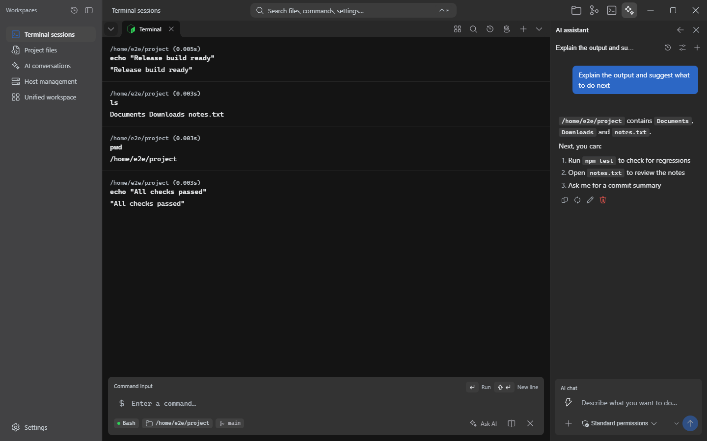
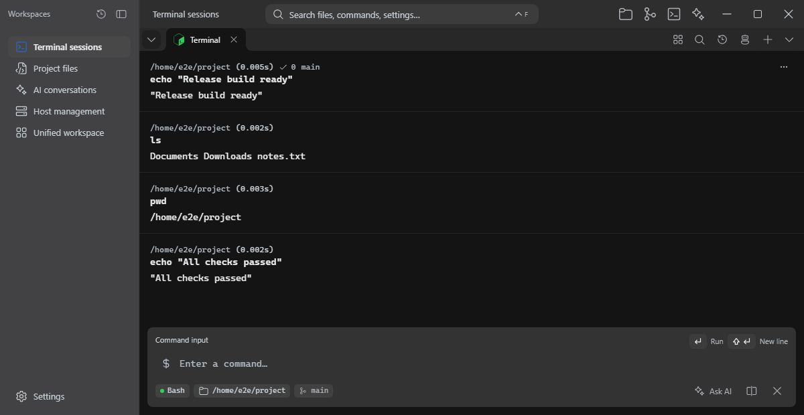
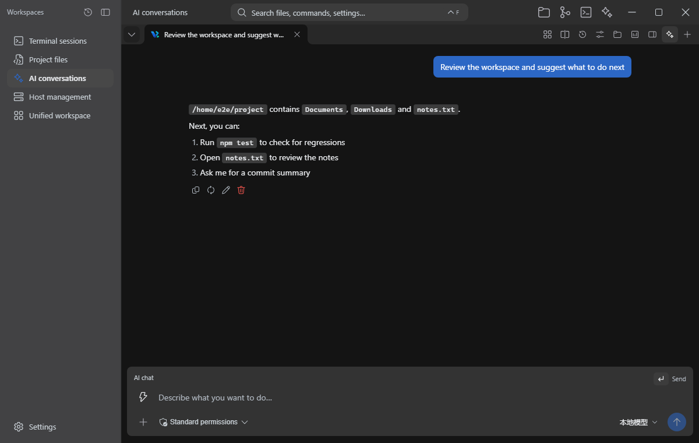
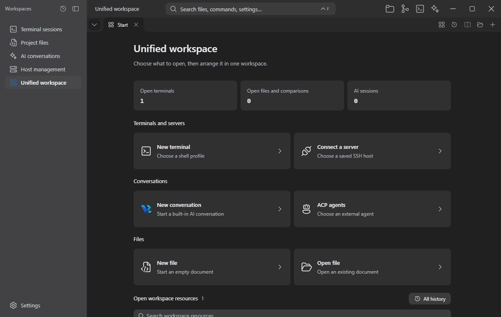
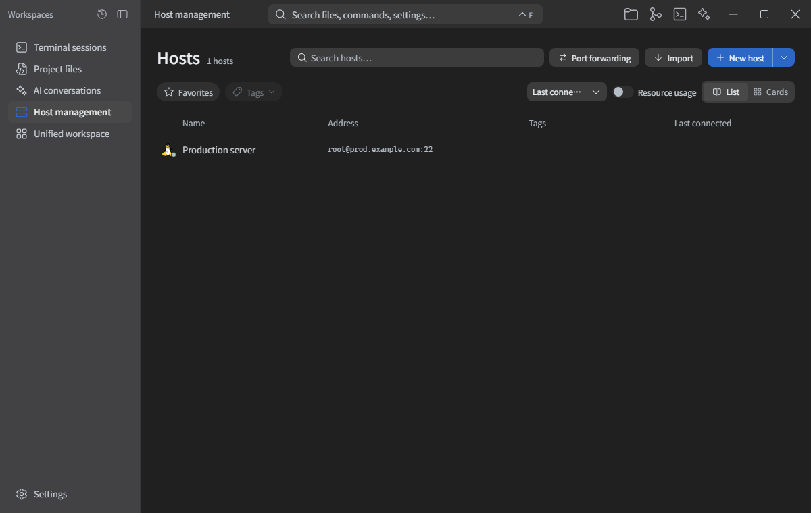

<div align="center">


# Vrykell

**Terminals, AI conversations and code in one desktop workspace.**

<p>
  <a href="#quick-start"></a>
  <a href="docs/en/feature-spec.md"></a>
  <a href="README.md"></a>
</p>

<p>
  
  
  
  
  
  
</p>

</div>

<p align="center">
  <a href="docs/images/hero-en-dark.png">
    
  </a>
</p>

<p align="center"><sub>Command blocks on the left; an AI conversation that can reference the output on the right.</sub></p>

## What is Vrykell?

Vrykell is a terminal-first desktop workbench for developers who spend their day in a terminal. It turns every command into a structured block, puts an AI agent next to it, and gives terminals, files, editors and conversations one shared model for tabs, splits and groups.

Most AI terminals put a chat window beside the terminal. Vrykell lets AI reference a specific command block, read its output, and then run commands, edit files or continue in a split. The app is built with Tauri 2 and runs on Windows, macOS and Linux.

**Design principles**

- **The terminal is the main surface.** AI is part of the command block and workspace, not another app to switch to.
- **Actions stay reviewable.** Blocks keep their context, tool calls ask for approval, and file changes can be checked on a diff page.
- **Local first.** Bring your own API key, connect directly to the provider and keep the key on this machine. Diagnostics record runtime metadata only.

## Quick start

You need Node.js 20+, a Rust toolchain and the [Tauri 2 system dependencies](https://v2.tauri.app/start/prerequisites/) for your platform.

```bash
git clone https://github.com/xtr-hub/Vrykell.git
cd Vrykell
npm install
npm run tauri dev      # full desktop app
npm run tauri build    # installer
```

For frontend-only work, run `npm run dev` (fixed port 1420).

<details>
<summary>Platform requirements</summary>

- **Windows**: uses the system WebView2 runtime.
- **macOS**: needs Xcode Command Line Tools, Perl and Make. SSH/SFTP libraries are built from source by Cargo; Homebrew and system OpenSSL are not required.
- **Linux**: needs the Tauri 2 system dependencies; see [Tauri prerequisites](https://v2.tauri.app/start/prerequisites/).
- **Tests**: `npm run test`, `npm run test:e2e`, `cargo test --manifest-path src-tauri/Cargo.toml`.

</details>

## Start with one command

### 1. Commands become blocks

Type `git status` into the input at the bottom. The result is not just scrollback: the block keeps the working directory, duration, exit status and Git branch together with the command and output. Running commands use a real terminal surface, so TUI apps, alternate screens, selection and IME input work as expected.

The block menu can copy the command or output, rerun it, clear it, or send it to AI. Command history is scoped by project, directory, shell and status, with favorites, custom groups, ordering and AI-assisted grouping.

<p align="center">
  <a href="docs/images/feature-terminal-en.png"></a>
</p>

### 2. Hand a failure to AI

Choose **Ask AI** in the block, or open the side conversation. The agent receives the current block as a reference and can read its output, search files, run commands and edit files. Execution and writes require approval by default; dangerous commands also go through the system confirmation.

```text
Why did the build fail? Find the cause, propose the smallest fix and list the files to change.
```

Inline agents and the side panel share conversations, drafts and streaming state. Models can come from Anthropic, Gemini or an OpenAI-compatible service; tools, skills, MCP servers and memory use the same settings.

<p align="center">
  <a href="docs/images/feature-ai-en.png"></a>
</p>

### 3. Terminal and editor share a workspace

Each area has its own tab strip. Terminals, editors, Git comparisons, files and conversations can be reordered, placed in named groups and split into up to four panes. The unified workspace mixes resource kinds in one tab or split without disturbing the layout already open.

Session history restores terminals and conversations only. Editor buffers, unsaved drafts and file browsing state stay in the live workspace instead of silently coming back after a restart.

<p align="center">
  <a href="docs/images/feature-unified-en.png"></a>
</p>

### 4. Remote hosts stay in the same workspace

The SSH/SFTP host manager supports passwords or keys, jump hosts, port forwarding and host-key confirmation. Remote directories can be browsed, uploaded, downloaded and opened for editing, and remote terminals use the same command blocks and AI as local ones.

<p align="center">
  <a href="docs/images/feature-ssh-en.png"></a>
</p>

## Feature details

<table>
<tr>
<td width="50%" valign="top">
  <br /><br />
  <b>Terminal and command history</b><br />
  Every command keeps its working directory, duration, exit status, branch and full output. Running blocks support TUI apps, alternate screens and IME. History is scoped by project, environment, shell and directory, with search, favorites, groups, ordering and AI grouping previews.
</td>
<td width="50%" valign="top">
  <br /><br />
  <b>AI and tools</b><br />
  Anthropic, Gemini and OpenAI-compatible providers; inline agents and side conversations share sessions. Approval policies, skills, MCP servers, local memory and external agents through ACP are all supported.
</td>
</tr>
<tr>
<td width="50%" valign="top">
  <br /><br />
  <b>Workspace and splits</b><br />
  An independent tab strip per area with drag ordering, named groups, folding, colors and empty-group cleanup. Up to four panes can be detached, merged or focused; the unified workspace puts terminals, files, editors and conversations in one tab.
</td>
<td width="50%" valign="top">
  <br /><br />
  <b>Remote, files and editor</b><br />
  SSH/SFTP, host management, jump hosts, port forwarding and host-key confirmation. Local and remote file panels share browsing, drag and drop, upload/download and undo. Built-in editor, Markdown preview, Git comparisons and a command palette.
</td>
</tr>
</table>

## Models and tools

Open **Settings → Model configuration**, add an upstream URL, API key and model, then choose the active model. Requests go directly to the provider, not through a Vrykell relay; the API key stays on this machine.

| Service | Notes |
| --- | --- |
| Anthropic | Native Messages API |
| Gemini | Native API |
| OpenAI compatible | Ollama, LM Studio, vLLM and other services exposing `/v1` |

Tool permissions live in **Settings → Tool permissions**. Standard asks according to tool rules, strict asks every time, and permissive still confirms dangerous commands and credential paths. Skills, MCP servers and memory have their own settings pages.

## Project status

- Current version: **0.1.0**, still in early development; UI and behavior may change.
- Session history restores terminals and conversations only; files, editor buffers and unsaved drafts do not survive a restart.
- On macOS, SSH/SFTP libraries are built from source by Cargo. Linux needs the Tauri 2 system dependencies.
- The repository does not ship an overall open-source license yet; all rights are reserved by default. Third-party licenses are listed in [NOTICE](NOTICE).

## Local development

```bash
npx tsc --noEmit                 # typecheck
npm run test                     # unit tests
npm run test:e2e                 # Playwright browser regressions
cargo test --manifest-path src-tauri/Cargo.toml
npm run check:architecture       # import boundaries and IPC registry
npm run build                    # production build
```

Run typechecking, unit tests and the architecture check before committing. Changes touching the terminal, workspace or AI also need the matching browser regressions.

## Documentation

<table>
<tr>
<td width="50%">
  <br /><br />
  <b><a href="docs/en/feature-spec.md">Feature spec</a></b><br />
  <sub>Behavior, boundaries and regression cases for every feature.</sub>
</td>
<td width="50%">
  <br /><br />
  <b><a href="docs/en/architecture.md">Architecture</a></b><br />
  <sub>Modules, the terminal pipeline and dependency direction.</sub>
</td>
</tr>
<tr>
<td width="50%">
  <br /><br />
  <b><a href="docs/en/development-rules.md">Development rules</a></b><br />
  <sub>Hard constraints, shared components, testing and commits.</sub>
</td>
<td width="50%">
  <br /><br />
  <b><a href="docs/en/security-model.md">Security model</a></b><br />
  <sub>IPC, rendering, file access and tool authorization boundaries.</sub>
</td>
</tr>
</table>

More: [Workspace foundation](docs/en/workspace-foundation.md) · [Runtime review](docs/en/workspace-runtime-review.md) · [ACP integration](docs/en/acp-harness-integration.md) · [SSH profiles](docs/en/ssh-profiles.md) · [Pitfalls](docs/en/pitfalls.md)

## Contributing

Issues and pull requests are welcome. Read the [development rules](docs/en/development-rules.md) and the [project conventions](.agents/skills/vrykell-conventions/SKILL.md) before you start.

## License

This repository does not ship an overall open-source license yet; all rights are reserved by default. Third-party dependency licenses are listed in [NOTICE](NOTICE).

<p align="center">
  <a href="https://github.com/xtr-hub/Vrykell/stargazers"></a>
</p>
