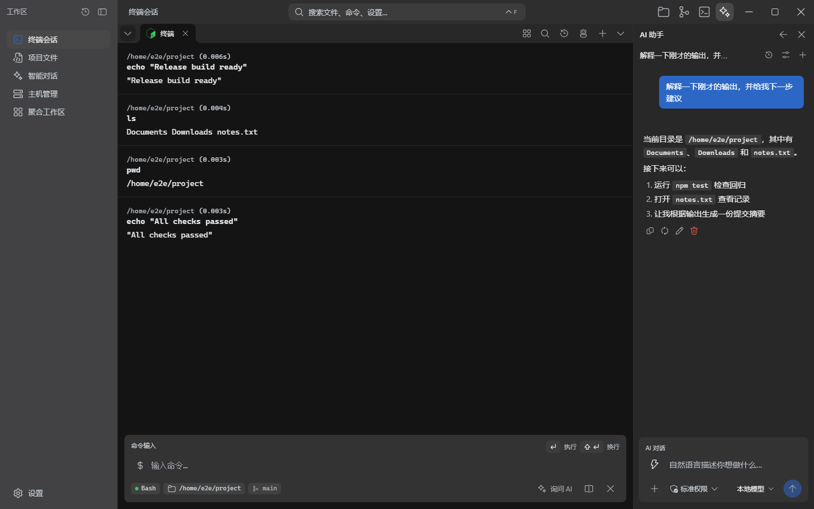
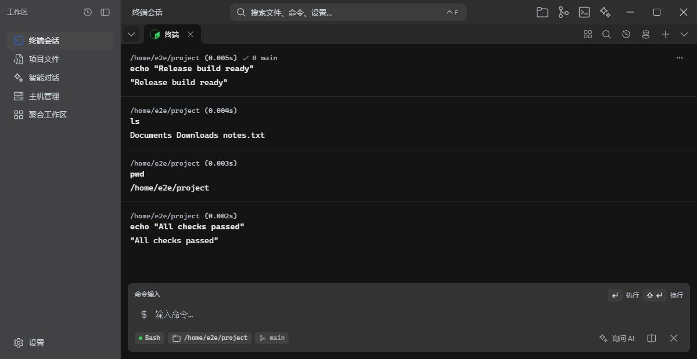
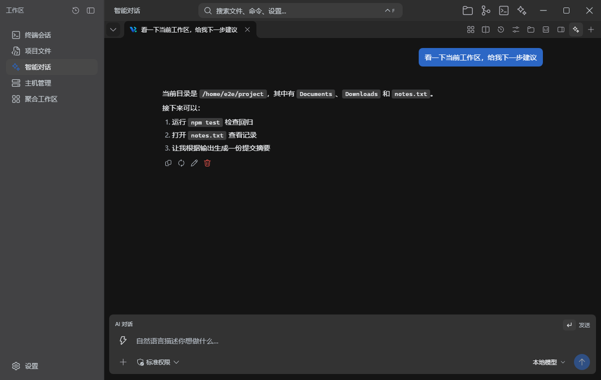
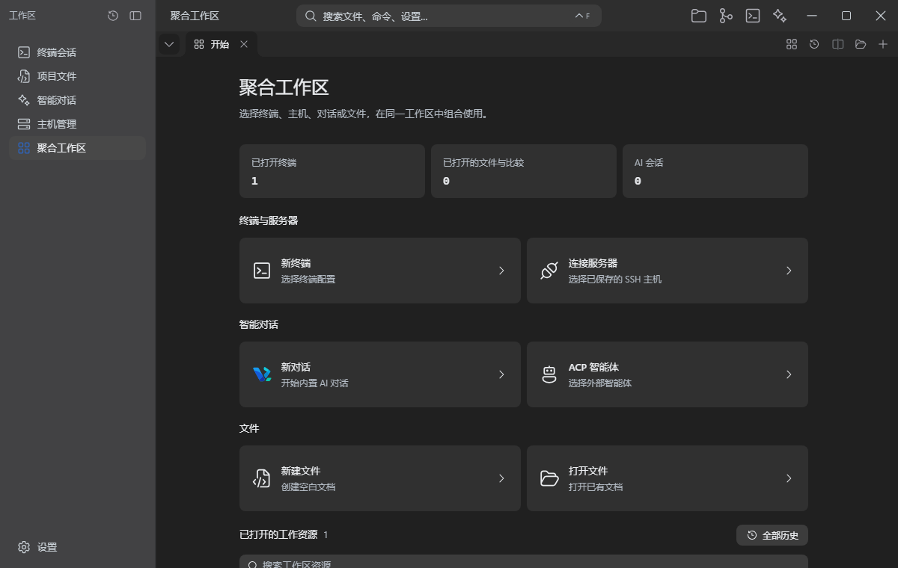
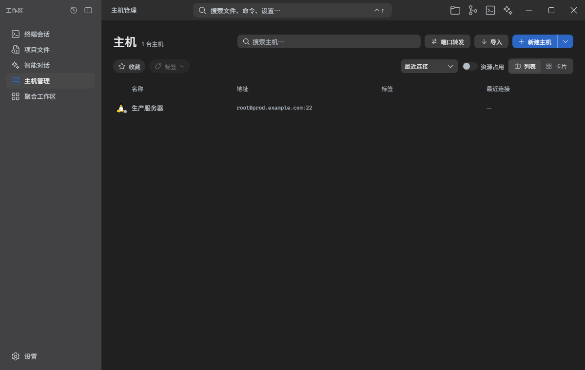

<div align="center">


# Vrykell

**终端、AI 对话和代码，在同一个桌面工作区。**

<p>
  <a href="#快速开始"></a>
  <a href="docs/zh/feature-spec.md"></a>
  <a href="README.en.md"></a>
</p>

<p>
  
  
  
  
  
  
</p>

</div>

<p align="center">
  <a href="docs/images/hero-dark.png">
    
  </a>
</p>

<p align="center"><sub>左侧是命令块终端，右侧是能引用命令输出并执行工具的 AI 对话。</sub></p>

## Vrykell 是什么

Vrykell 是一个终端优先的桌面工作台，面向每天在终端里工作的开发者。它把每条命令保存成结构化的命令块，把 AI Agent 放进命令旁边，并让终端、文件、编辑器和对话共享同一套标签、分屏与分组。

大多数 AI 终端只是把聊天窗口贴在终端旁边。Vrykell 让 AI 能引用具体命令块、读取输出，并在需要时执行命令、编辑文件或继续分屏处理。应用使用 Tauri 2 构建，支持 Windows、macOS 和 Linux。

**设计原则**

- **终端是主界面**：AI 是命令块和工作区的一部分，不是另一个需要来回切换的应用。
- **操作可回看、可撤销**：命令块保留上下文，工具调用先确认，文件修改可以回到差异页检查。
- **本地优先**：自带 API Key 直连模型服务，密钥留在本机；诊断日志只记录运行元数据。

## 快速开始

需要 Node.js 20+、Rust 工具链，以及当前平台的 [Tauri 2 系统依赖](https://v2.tauri.app/start/prerequisites/)。

```bash
git clone https://github.com/Vrykell/Vrykell.git
cd Vrykell
npm install
npm run tauri dev      # 启动完整桌面应用
npm run tauri build    # 构建安装包
```

只开发前端时运行 `npm run dev`（固定端口 1420）。

<details>
<summary>平台依赖</summary>

- **Windows**：使用系统 WebView2。
- **macOS**：需要 Xcode Command Line Tools、Perl 和 Make。SSH/SFTP 依赖由 Cargo 从源码构建，不需要 Homebrew 或系统 OpenSSL。
- **Linux**：需要 Tauri 2 系统依赖，完整安装命令见 [Tauri prerequisites](https://v2.tauri.app/start/prerequisites/)。
- **测试**：`npm run test`、`npm run test:e2e`、`cargo test --manifest-path src-tauri/Cargo.toml`。

</details>

## 从一条命令开始

### 1. 命令变成块

在底部输入 `git status`，执行后不会只留下滚动的输出。每个块记录工作目录、耗时、退出码和 Git 分支；命令、输出和操作都在同一个块里。运行中的命令使用真实终端渲染，TUI、备用屏幕、选区复制和输入法都能工作。

块内菜单可以复制命令或输出、重新运行、清除，或把这块输出交给 AI。命令历史按项目、目录、Shell 和状态筛选，支持收藏、自定义分组、排序和 AI 自动分组。

<p align="center">
  <a href="docs/images/feature-terminal.png"></a>
</p>

### 2. 把失败输出交给 AI

点击块内的「询问 AI」，或打开侧栏对话。Agent 会拿到当前命令块作为引用，可以读取输出、搜索文件、执行命令和编辑文件；执行和写入默认需要确认，危险命令还会走系统级确认。

```text
为什么刚才的构建失败了？定位原因，给出最小修复，并说明要改哪些文件。
```

内联 Agent 和侧栏对话共享会话、草稿和流式状态。模型可以来自 Anthropic、Gemini 或 OpenAI 兼容服务；工具、Skills、MCP 服务器和记忆使用同一套设置。

<p align="center">
  <a href="docs/images/feature-ai.png"></a>
</p>

### 3. 终端和编辑器共享工作区

每个区域有自己的标签条。终端、编辑器、Git 对比、文件和对话可以拖动排序、命名分组，最多拆成四个窗格；聚合工作区允许把不同类型的资源放进同一个标签或分屏，打开新资源不会打乱已有布局。

会话历史只恢复终端和对话。编辑器内容、未保存草稿和文件浏览状态留在当前工作区，避免重启后悄悄恢复过期文件。

<p align="center">
  <a href="docs/images/feature-unified.png"></a>
</p>

### 4. 远程主机也在同一工作区

SSH/SFTP 主机管理器支持密码或密钥、端口转发和主机指纹确认；跳板机可用于交互终端，但文件浏览和资源监控暂不支持跳板机。直连主机的远程目录可以浏览、上传、下载和打开编辑，远程终端与本地终端一样使用命令块和 AI。

<p align="center">
  <a href="docs/images/feature-ssh.png"></a>
</p>

## 功能细节

<table>
<tr>
<td width="50%" valign="top">
  <br /><br />
  <b>终端与命令历史</b><br />
  每条命令保留工作目录、耗时、退出码、分支和完整输出；运行中的块支持 TUI、备用屏幕和输入法。历史按项目、环境、Shell 和目录归属，支持搜索、收藏、分组、排序和 AI 分组预览。
</td>
<td width="50%" valign="top">
  <br /><br />
  <b>AI 与工具</b><br />
  Anthropic、Gemini 和 OpenAI 兼容服务；内联 Agent 与侧栏对话共享会话。支持工具审批、Skills、MCP 服务器、本地记忆，以及通过 ACP 接入的外部 Agent。
</td>
</tr>
<tr>
<td width="50%" valign="top">
  <br /><br />
  <b>工作区与分屏</b><br />
  每个区域独立标签条，支持拖拽排序、命名分组、折叠、配色和空组清理。最多四个窗格，可拆出、合并或切换焦点；聚合工作区把终端、文件、编辑器和对话放进同一标签。
</td>
<td width="50%" valign="top">
  <br /><br />
  <b>远程、文件与编辑器</b><br />
  SSH/SFTP、主机管理、端口转发和指纹确认；跳板机用于交互终端。本地与远程文件面板共享浏览、拖放、上传下载和撤销；远程文件暂不支持跳板机。内置编辑器、Markdown 预览、Git 差异和命令面板。
</td>
</tr>
</table>

## 模型与工具

打开 **设置 → 模型配置**，添加上游地址、API Key 和模型，然后选择当前模型。请求直接发给模型服务商，不经过 Vrykell 的中转服务；API Key 保存在本机。

| 服务 | 说明 |
| --- | --- |
| Anthropic | 原生 Messages API |
| Gemini | 原生 API |
| OpenAI compatible | Ollama、LM Studio、vLLM 等兼容 `/v1` 的服务 |

工具权限在 **设置 → 工具权限** 中调整。标准档按工具规则询问，严格档逐次询问，放行档仍会确认危险命令和凭据路径。Skills、MCP 服务器和记忆分别有独立设置页。

## 项目状态

- 当前版本 **0.1.0**，仍在早期开发，界面和行为可能变化。
- 会话历史只保存终端和对话；文件、编辑器缓冲区和未保存草稿不会跨重启恢复。
- macOS 的 SSH/SFTP 依赖由 Cargo 从源码构建；Linux 需要 Tauri 2 系统依赖。
- 原创代码和文档采用 [Apache-2.0](LICENSE)；第三方软件与资源保留各自许可证，见 [NOTICE](NOTICE)。

## 本地开发

```bash
npx tsc --noEmit                 # 类型检查
npm run test                     # 单元测试
npm run test:e2e                 # Playwright 浏览器回归
cargo test --manifest-path src-tauri/Cargo.toml
npm run check:architecture       # 导入边界与 IPC 注册表检查
npm run build                    # 生产构建
```

提交前至少运行类型检查、单元测试和架构检查。终端、工作区和 AI 相关改动还需要运行对应的浏览器回归。

自动检查与 `main` 分支安装包构建流程见[持续集成与安装包](docs/zh/ci.md)。

## 文档

<table>
<tr>
<td width="50%">
  <br /><br />
  <b><a href="docs/zh/feature-spec.md">功能规格</a></b><br />
  <sub>每个功能的行为、边界和回归用例。</sub>
</td>
<td width="50%">
  <br /><br />
  <b><a href="docs/zh/architecture.md">架构</a></b><br />
  <sub>模块划分、终端管线和依赖方向。</sub>
</td>
</tr>
<tr>
<td width="50%">
  <br /><br />
  <b><a href="docs/zh/development-rules.md">开发规则</a></b><br />
  <sub>硬约束、共享组件、测试和提交要求。</sub>
</td>
<td width="50%">
  <br /><br />
  <b><a href="docs/zh/security-model.md">安全模型</a></b><br />
  <sub>IPC、渲染、文件访问和工具授权边界。</sub>
</td>
</tr>
</table>

其他文档：[工作区底层](docs/zh/workspace-foundation.md) · [工作区组合](docs/zh/workspace-compositions.md) · [应用工具](docs/zh/application-tools.md) · [SSH 配置](docs/zh/ssh-profiles.md) · [踩坑记录](docs/zh/pitfalls.md)

## 贡献

欢迎提交 Issue 和 PR。开始之前请阅读[开发规则](docs/zh/development-rules.md)和[项目约定](.agents/skills/vrykell-conventions/SKILL.md)。

除非明确另作说明，为纳入本项目而提交的贡献按项目许可证提供。第三方材料的原始声明和许可证必须保留。

## 许可

除另有说明外，原创代码和文档采用 [Apache License 2.0](LICENSE)。版权归属：Copyright 2026 Vrykell contributors。

第三方软件、字体与图标保留各自许可证。署名、源码获取方式及分发要求见 [NOTICE](NOTICE)、[第三方声明](THIRD_PARTY_NOTICES.md)和[许可说明](docs/zh/licensing.md)。

<p align="center">
  <a href="https://github.com/Vrykell/Vrykell/stargazers"></a>
</p>
