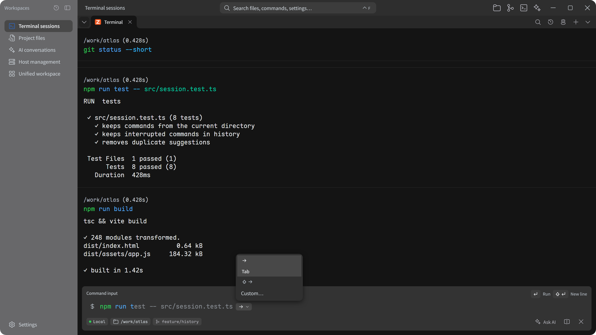
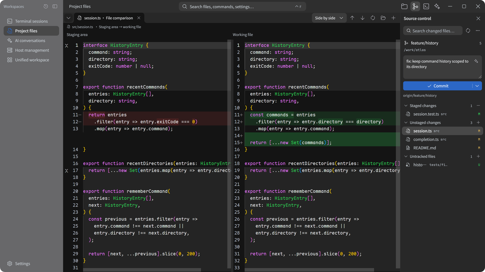
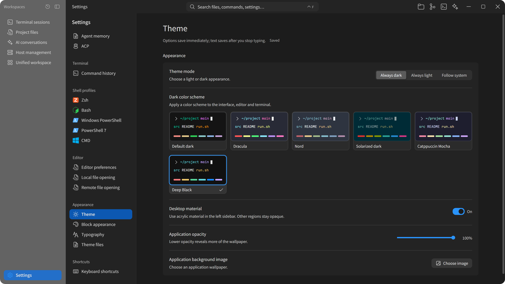

<div align="center">


# Vrykell

**Your terminal, your tools, your AI — together.**

A desktop workspace for development and remote operations, built around the terminal.

**[Download Beta](#download)** &nbsp; · &nbsp; [Explore features](#features) &nbsp; · &nbsp; [Build from source](#build-from-source) &nbsp; · &nbsp; [简体中文](README.zh-CN.md)

<p>
  <a href="LICENSE"></a>
  
</p>

</div>

<a href="docs/images/hero-workspace-en.png"></a>

<p align="center"><sub>Code, run commands, and work with an agent in the same workspace.</sub></p>

---

## Download

**0.1.0 Beta 3** is the latest preview. Check the [current boundaries](#current-boundaries) before using it for daily work. The screenshots and feature descriptions follow the development branch, which may be ahead of the packaged release.

| Platform | Package |
| --- | --- |
| Windows x64 | [.exe](https://github.com/Vrykell/Vrykell/releases/download/v0.1.0-beta.3/Vrykell_0.1.0_x64-setup.exe) |
| macOS Apple silicon | [.dmg](https://github.com/Vrykell/Vrykell/releases/download/v0.1.0-beta.3/Vrykell_0.1.0_aarch64.dmg) |
| macOS Intel | [.dmg](https://github.com/Vrykell/Vrykell/releases/download/v0.1.0-beta.3/Vrykell_0.1.0_x64.dmg) |
| Linux amd64 | [.deb](https://github.com/Vrykell/Vrykell/releases/download/v0.1.0-beta.3/Vrykell_0.1.0_amd64.deb) · [.AppImage](https://github.com/Vrykell/Vrykell/releases/download/v0.1.0-beta.3/Vrykell_0.1.0_amd64.AppImage) |

[All releases and release notes](https://github.com/Vrykell/Vrykell/releases) · [Build instructions](docs/en/ci.md)

The [Beta 3 release notes](https://github.com/Vrykell/Vrykell/releases/tag/v0.1.0-beta.3) record package checksums, the source commit and validation limits. Installers remain unsigned; build the current source when later fixes are required. See the [security policy](SECURITY.md) before reporting a vulnerability.

## One workspace, from command to commit

- **[Terminal and completion](#terminal-and-completion)** — command blocks, classic mode, history suggestions, shell and path completion.
- **[Files and editor](#files-and-editor)** — local and SFTP browsing, transfers, editor tabs and Markdown preview.
- **[Git](#git)** — diffs, staging, commits, branches and remote operations.
- **[SSH](#ssh)** — saved hosts, authentication, forwarding and resource status.
- **[AI and agents](#ai-and-agents)** — bring your own model, attach output or images, and connect external agents.
- **[Your layout](#workflows)** — up to four mixed panes per tab, named tab groups and a dockable conversation sidebar.

## Features

### Terminal and completion

Keep a continuous screen in classic mode, or use blocks to keep each command with its output, working directory, branch, duration and exit status. Full-screen programs use an interactive terminal screen. Search command history, save favorites and organize commands into groups.

History suggestions appear as you type. Local matching and path completion work without a model key; optional AI completion uses your configured model when local suggestions are unavailable. Tab completion combines built-in suggestions, supported shell completion and paths in the current local or SSH directory, including quoted paths and names with spaces.

Use `Tab` and `Shift+Tab` to cycle candidates and `Esc` to restore the original input. Suggestion acceptance keys are configurable.

<a href="docs/images/feature-completion-en.png"></a>

<details>
<summary>Terminal workspace with the AI sidebar</summary>

<a href="docs/images/single-terminal-en.png"></a>

</details>

### Files and editor

Browse local directories or remote files over SFTP. Create, rename, copy, move and delete files and folders, including multiple selections. Uploads and downloads have a transfer list. Open files in the built-in editor or a configured external application.

The editor has syntax highlighting, find and replace, Markdown preview, character encodings and Vim bindings. Files stay in tabs, with read-only states, unsaved changes and save conflicts shown before an overwrite. With the built-in editor selected, unsupported file types open in the system default application. Remote files open as downloaded copies; changes to those copies do not sync back.

<details>
<summary>Project files and editor</summary>

<a href="docs/images/single-editor-en.png"></a>

</details>

### Git

The source control panel follows the current terminal or file, including saved SSH connections. It uses Git installed on the local machine or remote host.

- Review conflicts, staged, unstaged and untracked files in a list or tree. Open diffs, stage or unstage files, and confirm before discarding changes.
- Write a commit message and commit; an optional AI action drafts a message for review.
- Fetch, pull and push. Create, switch, rename or delete branches; merge, rebase and manage tags.
- Browse linked worktrees and switch the repository shown in the panel.

A typical review is **open the diff → stage the intended files → check the message → commit → push**. The terminal remains available for other commands.

<a href="docs/images/feature-git-en.png"></a>

### SSH

Manage hosts in a list or as cards, then find a target by name, group or tag. Saved connections support password and key authentication, host-key confirmation and port forwarding. Direct connections also support SFTP browsing, remote editing, transfers and resource status on demand.

<a href="docs/images/single-hosts-en.png"></a>

### AI and agents

Use a plain conversation, or attach text, files, images and command output. Image input requires a capable model. For execution tasks, choose the target terminal and review tool calls and permission requests in the conversation.

Built-in conversations support streaming, multiple model configurations, skills, MCP and local memory. External agents connect through ACP and provide their own models and tools. Either can run in a pane or the sidebar, with separate conversations for separate tasks.

<a href="docs/images/single-ai-en.png"></a>

## Workflows

Each tab holds up to four panes: terminals, files, AI conversations or external agents. Drag panes to rearrange them. Name and color tab groups, then collapse the ones you are not using. Sessions and conversations keep running when you switch tabs.

### Edit on the left. Build on the right.

Open a source file beside a test or build terminal. Edit, run the command and compare the result. Attach a failed command block to a conversation when you need help with its output.

<a href="docs/images/scenario-build-en.png"></a>

### SSH on the left. AI on the right.

Check a service or deployment log over SSH. Keep the output visible while discussing it, and check the selected execution environment before asking an agent to act.

<a href="docs/images/scenario-remote-en.png"></a>

To review an agent's changes, keep its execution terminal beside the conversation and open the affected file or Git diff. For multiple projects, use a group for each project rather than mixing their sessions.

## Themes and fonts

Eleven built-in schemes cover six dark and five light choices, including a neutral Deep Black option. The original dark and light palettes remain available. Dark and light selections are saved independently, with an option to follow the system.

Set fonts and sizes separately for the interface, editor, terminal and chat. Bundled fonts work without a separate installation. You can also choose a local wallpaper and adjust application opacity.

<a href="docs/images/theme-settings-en.png"></a>

<a href="docs/images/theme-light-en.png"></a>
<a href="docs/images/theme-nord-en.png"></a>

<details>
<summary>Deep Black</summary>

<a href="docs/images/theme-deep-black-en.png"></a>

</details>

Screenshots use the application UI with a sample project and simulated session data. Click an image for its original resolution.

## Build from source

Install Node.js **22.12+**, a stable Rust toolchain and your platform's [desktop build prerequisites](https://v2.tauri.app/start/prerequisites/).

```bash
git clone https://github.com/Vrykell/Vrykell.git
cd Vrykell
npm ci
npm run tauri dev
```

For frontend-only development, use `npm run dev` on port `1420`. To build an installer, run `npm run tauri -- build`.

<details>
<summary>Platform preparation</summary>

- **Windows**: C++ build tools, the system WebView2 runtime and the desktop SDK needed by the native context menu.
- **macOS**: command-line development tools, Perl and Make. Native SSH dependencies build from source without a separately installed system cryptography library.
- **Linux**: desktop WebView, GUI and application-indicator development dependencies; see the prerequisites above.

</details>

### Connect a model or agent

Add a model service URL, key and model in settings, then select the active configuration. Built-in conversations support native Messages and generation interfaces and OpenAI-compatible endpoints, including compatible local model services. Requests go directly to the service you configure; the application does not provide a model relay.

Configure an external agent's startup command and working directory in ACP settings. Review tool permissions before starting. With remote targets, also check the selected execution terminal and directory so the execution environment is clear.

### Current boundaries

- Sessions and composition layouts can enter history. Unsaved editor drafts and file browsing state are not a reliable way to preserve work across restarts.
- Model services, external agents and remote hosts require your configuration. Their costs and capabilities depend on the services you choose.
- Jump-host support focuses on interactive terminals; browsing and monitoring do not cover the same connection paths yet.
- Distribution signing and notarization are not configured. See [CI and packages](docs/en/ci.md).

## Contributing

Bug reports, documentation, translations, tests and code contributions are welcome. Include reproduction steps and your platform when reporting a bug. For a substantial feature, open an issue to discuss the intended behavior first.

**Contribution PRs target `dev`.** Maintainers use `main` for integration and version builds. Read the [contributing guide](CONTRIBUTING.en.md) for branch naming, setup, checks and review.

```bash
npx tsc --noEmit
npm run test
npm run check:architecture
```

Interactive changes also need matching browser regressions, and backend changes need native tests. Commit messages use English and the agreed prefixes. Commit, PR and issue templates are included.

## Community

Join the community group to share ideas, ask questions and follow the project. Group number: **1130135497**.

<a href="docs/images/community-group.jpg"></a>

## Read more

- [Features and regression checklist](docs/en/feature-spec.md)
- [Architecture](docs/en/architecture.md)
- [Workspace compositions](docs/en/workspace-compositions.md)
- [Development rules](docs/en/development-rules.md)
- [Security model](docs/en/security-model.md)
- [CI and packages](docs/en/ci.md)

## License

Original code and documentation use the [Apache License, Version 2.0](LICENSE), except where otherwise stated. Copyright 2026 Vrykell contributors.

Third-party software, fonts and icons retain their own terms and attribution. See [NOTICE](NOTICE), [third-party notices](THIRD_PARTY_NOTICES.md) and the [licensing guide](docs/en/licensing.md). Unless explicitly stated otherwise, contributions submitted for inclusion are offered under the project license.
