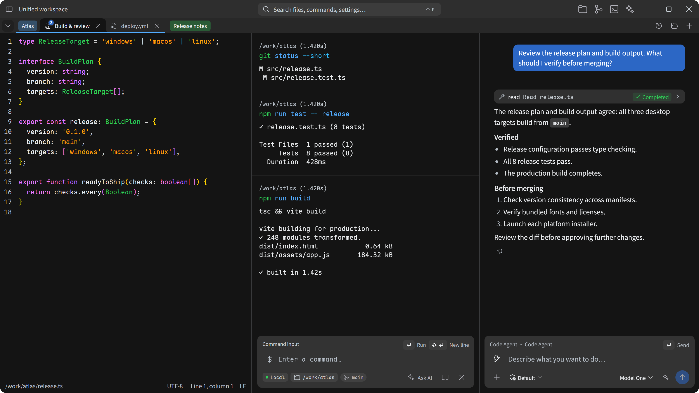
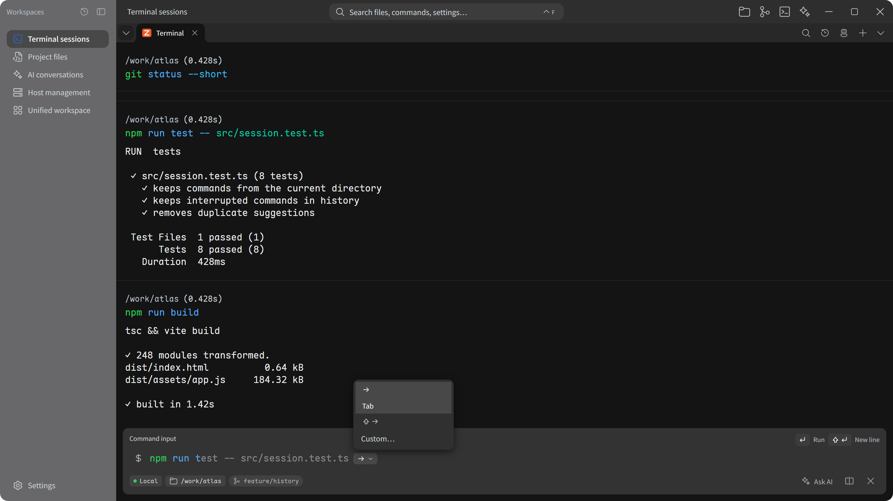
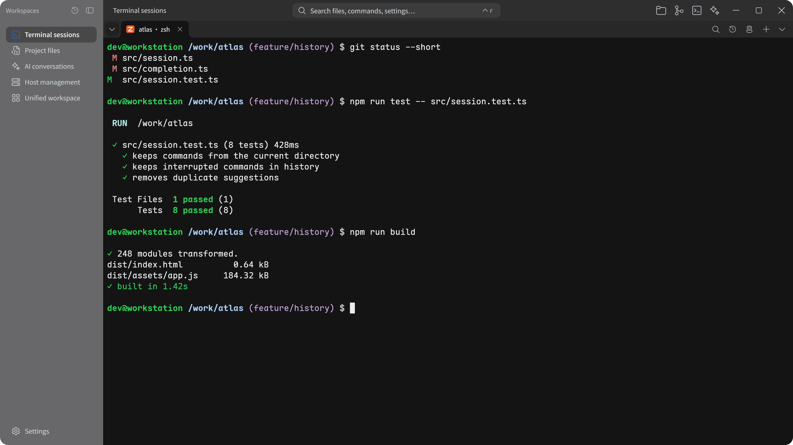
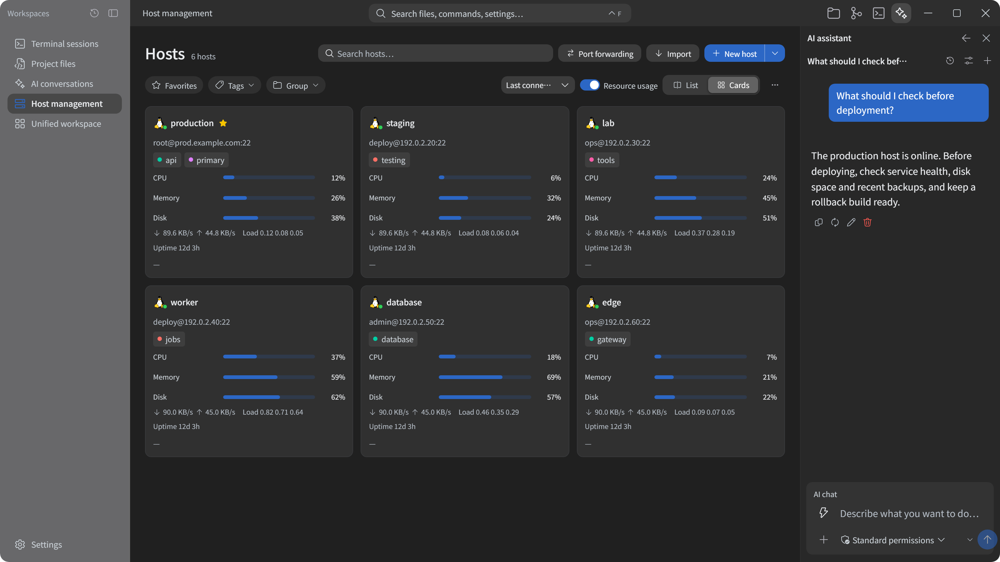
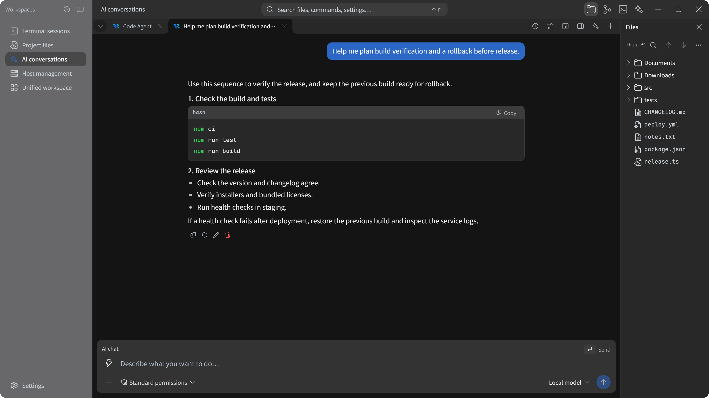
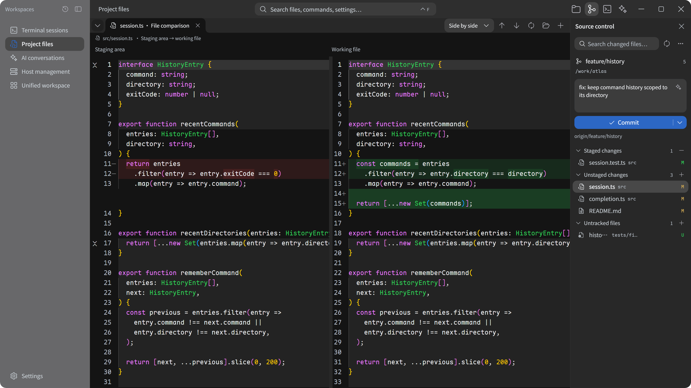
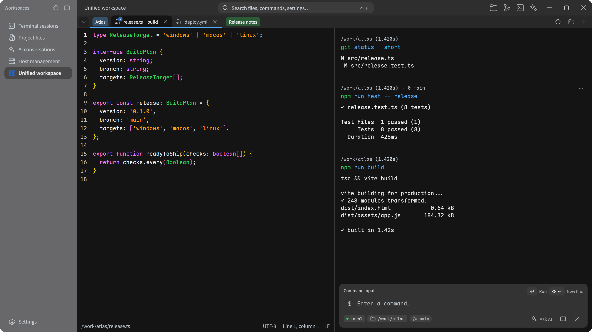
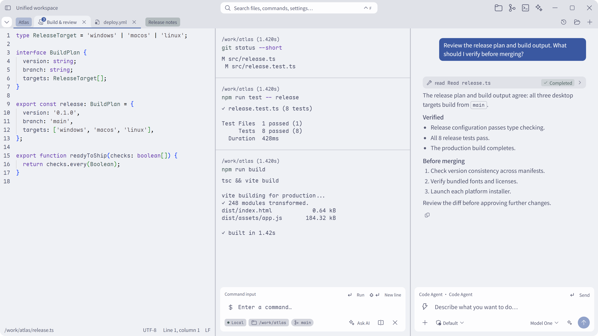
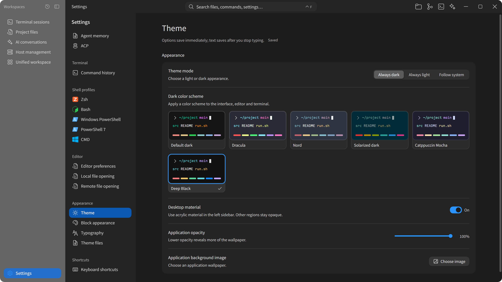
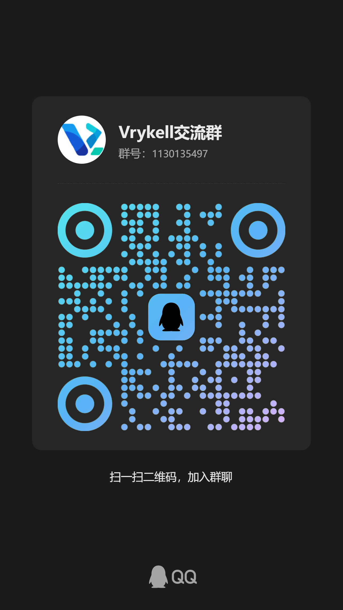

<div align="center">


# Vrykell

**A terminal workbench for development and remote operations.**

Keep command context, manage SSH connections and services, and bring your ACP agents into one client with explicit execution targets.

**[Download](#download)** &nbsp; · &nbsp; [How it works](#working-with-vrykell) &nbsp; · &nbsp; [Build from source](#build-from-source) &nbsp; · &nbsp; [简体中文](README.zh-CN.md)

<p>
  <a href="LICENSE"></a>
  
</p>

<p>
  <a href="https://www.producthunt.com/products/vrykell?embed=true&amp;utm_source=badge-featured&amp;utm_medium=badge&amp;utm_campaign=badge-vrykell"><picture><source media="(prefers-color-scheme: dark)" srcset="https://api.producthunt.com/widgets/embed-image/v1/featured.svg?post_id=1300533&amp;theme=dark"></picture></a>
</p>

<p>
<a href="https://atomgit.com/Vrykell/Vrykell" target="_blank" rel="noopener noreferrer">
  
</a>
</p>

</div>

<a href="docs/images/hero-workspace-en.png"></a>

Vrykell organizes development and remote work around live shell sessions. Each command can retain its directory, output and result; files and diffs follow the environment you are working in; a conversation can explicitly select that environment for execution.

The workflow extends from **running a command to understanding its result, changing a file and reviewing the change**. You can carry a failed command's context into a conversation, keep the execution terminal visible as an agent works, then inspect the resulting diff before committing.

## Working with Vrykell

### 1. Inspect commands as individual runs

Block mode keeps a command with its working directory, branch, output, duration and exit status. A failed build remains an identifiable run as you continue working. You can rerun it in its owning terminal, copy its command or output, or stage a snapshot in a conversation for review before sending.

The terminal supports three working states:

| State | Use |
| --- | --- |
| Command blocks | Inspect individual runs and refer back to their context and results. |
| Classic terminal | Work with a continuous terminal screen, including shells without block integration. |
| Full-screen interaction | Use an interactive editor, pager or monitor, then return to the previous view when it exits. |

History suggestions and local path completion work without a model key. Tab completion combines built-in candidates, supported shell completion and paths in the current local or SSH directory, including quoted paths and names with spaces. Optional AI completion uses your configured model when local suggestions are unavailable. History can be searched, grouped and saved as favorites.

<a href="docs/images/feature-completion-en.png"></a>

<a href="docs/images/feature-classic-en.png"></a>

<p align="center"><sub>Classic mode keeps shell prompts and output on one continuous screen.</sub></p>

### 2. Work through an SSH connection, beyond its prompt

A saved host holds authentication, jump connections, proxy selection, forwarding rules, environment variables and notes. Groups, tags and favorites help organize hosts; importing existing connection configuration reduces repeated setup.

| Capability | Behavior |
| --- | --- |
| Routes and trust | Saved jump profiles can form routes of up to eight hops, with separate credentials and host-key verification at each hop. Standard routes support file browsing, resource monitoring and managed forwarding. |
| Interactive authentication | Service authentication supports password and key passphrases, plus multi-round server challenges such as MFA. Files and monitoring can reuse the authenticated destination transport; challenge answers are never cached for reconnects. |
| Files and transfers | Browse and manage files over SFTP, with upload and download tasks in a transfer list. |
| Resource status | Inspect CPU, memory, root-disk usage and network traffic alongside the session. Collection is on demand. |
| Managed forwarding | Start and stop local, remote and dynamic forwarding rules independently of terminal tabs. Closing a terminal does not itself stop a managed forward. |

Terminal access and service access have distinct requirements. A gateway that exposes only an interactive menu does not automatically provide SFTP, monitoring or forwarding. Transfers and managed forwarding also authenticate separately from the retained interactive service transport. The [connection guide](docs/en/ssh-profiles.md) explains these paths and their lifetimes.

<a href="docs/images/single-hosts-en.png"></a>

### 3. Give an agent a specific execution environment

Conversations can stand alone or use a selected local or SSH terminal. Attach a command block, text, files or images rather than reconstructing a failure from memory. Image input depends on model support. The application's execution tools follow these rules:

- **Keep execution tied to its target.** A turn captures the selected terminal; changing workspace focus does not redirect it. A disconnected target reports an error. With a remote target, application-provided local file tools are unavailable.
- **Check completion before continuing.** Command execution waits for supported shell completion signals and reports output and exit status when available. A quiet screen alone is not treated as completion. An unconfirmed command stops queued successors so the terminal can be inspected.
- **Review tool access.** Tools have allow, ask and deny policies, with session approvals and native confirmation for sensitive operations. Calls, results and approval outcomes stay in the conversation.

Use the built-in agent with your own model endpoint, skills, MCP tools and scoped local memory, or connect an external agent through ACP. External sessions can use application tools through the same implementations and permission path. Tools independently provided by an external agent are managed by that agent. See [application tools](docs/en/application-tools.md) and the [security model](docs/en/security-model.md).

#### One client for a 20+ agent ecosystem

Choose from the growing [ACP agent ecosystem](https://github.com/agentclientprotocol/registry), with 20+ agent choices available through presets or custom local commands. Eleven built-in startup presets include Claude Code, Codex, Gemini CLI, OpenCode, Qwen Code, Cursor, OpenClaw, Kiro CLI, Kimi CLI, Goose and Pi. Additional compatible agents can be configured with their command, arguments, environment and project directory.

| In the same client | What stays independent |
| --- | --- |
| Multiple agent profiles and conversation tabs | Each conversation retains its draft, project context, streamed reply and cancellation state. |
| Main panes and a dockable conversation sidebar | Switch agents or move a conversation while keeping its live session and draft. |
| Models, modes and session settings | Controls follow the capabilities reported by the selected agent. |
| Terminal and file tools | Select the execution target explicitly and review application-tool approvals in the transcript. |

Add a preset or custom command in **Settings → ACP**, install and authenticate the selected agent, then choose its project directory when opening a conversation. Agent availability, authentication, models and optional protocol capabilities depend on that agent. Presets are startup configurations; the registry is the reference for the wider ecosystem.

<a href="docs/images/single-ai-en.png"></a>

### 4. Turn execution into a reviewed change

Open a source file beside the terminal that runs its tests. The built-in editor supports syntax highlighting, find and replace, Markdown preview, encodings and Vim bindings. Unsaved changes, read-only states and save conflicts are handled explicitly.

Source control follows the current terminal or file, including saved SSH connections, or can stay bound to a terminal while focus changes. Review staged and unstaged diffs separately, inspect conflicts, stage whole files and commit the index while retaining unstaged edits. Fetch, pull and push, branch and tag operations, and linked-worktree browsing are available in the panel. Pulls use fast-forward updates; AI-generated commit messages remain drafts for review.

Each tab can combine up to four terminal, file, comparison or conversation panes. Moving panes and switching views preserve their live owners, so arranging the workspace does not restart terminal processes or duplicate conversations. Named tab groups, pane zoom and a dockable conversation sidebar help keep separate tasks organized.

Remote files opened in the editor are downloaded copies; saving them does not automatically upload changes. Git operations use the Git installation on the relevant local machine or remote host.

<a href="docs/images/feature-git-en.png"></a>

<details>
<summary>Example layout: edit beside a build terminal</summary>

<a href="docs/images/scenario-build-en.png"></a>

</details>

## Implementation and verification

The terminal's command-level behavior is backed by an explicit lifecycle. A synchronous Rust scanner preserves the order of shell integration markers in PTY output. A controller per session tracks command boundaries and transitions between blocks, classic mode and full-screen interaction. VT/ANSI parsing stays with the terminal engine; completed block output is presented as DOM. See the [architecture](docs/en/architecture.md).

Mixed layouts store references to resources owned by their respective domains. Moving a pane changes placement while the process, document or conversation keeps its identity. History restoration resolves those references through their owners, with errors for missing content. See [workspace compositions](docs/en/workspace-compositions.md).

The repository includes unit, browser and native regression suites. They cover delayed command markers, full-screen transitions, fixed agent targets, unconfirmed execution, permission cancellation and workspace restoration. An isolated SSH protocol check exercises disposable loopback servers for multi-hop authentication, files, resources, forwarding and host-key rejection. The [feature checklist](docs/en/feature-spec.md) links behavior to verification; [CI documentation](docs/en/ci.md) distinguishes automated checks from opt-in platform and package validation.

<details>
<summary>Appearance: themes, typography and wallpaper</summary>

Eleven built-in color schemes include dark and light choices, saved independently, with an option to follow the system. Set fonts and sizes separately for the interface, editor, terminal and chat. Bundled fonts work without a separate installation; local wallpaper and application opacity are configurable.

<a href="docs/images/theme-light-en.png"></a>
<a href="docs/images/theme-deep-black-en.png"></a>

</details>

Screenshots show the application with a sample project and simulated session data. They follow the development branch and may be ahead of the packaged release.

## Download

Current stable release: **0.1.8**.

| Platform | Package |
| --- | --- |
| Windows x64 | [.exe](https://github.com/Vrykell/Vrykell/releases/download/v0.1.8/Vrykell_0.1.8_x64-setup.exe) |
| macOS Apple silicon | [.dmg](https://github.com/Vrykell/Vrykell/releases/download/v0.1.8/Vrykell_0.1.8_aarch64.dmg) |
| macOS Intel | [.dmg](https://github.com/Vrykell/Vrykell/releases/download/v0.1.8/Vrykell_0.1.8_x64.dmg) |
| Linux amd64 | [.deb](https://github.com/Vrykell/Vrykell/releases/download/v0.1.8/Vrykell_0.1.8_amd64.deb) · [.AppImage](https://github.com/Vrykell/Vrykell/releases/download/v0.1.8/Vrykell_0.1.8_amd64.AppImage) |

[All releases](https://github.com/Vrykell/Vrykell/releases) · [Release notes](https://github.com/Vrykell/Vrykell/releases/tag/v0.1.8)

Release notes record package checksums, the exact source commit and validation coverage. Update signatures verify updater payloads; they do not replace operating-system distribution signing or notarization. The capability descriptions above follow the development branch; build the current source for changes made after the packaged release.

### Current boundaries

- **Persistence:** session history and composition layouts are supported. Unsaved editor drafts and file browsing state are not reliable cross-restart storage; a restored layout does not resume an old running process.
- **Remote work:** editor copies do not sync back automatically. Interactive-only gateways may not expose service channels; transfers and managed forwarding have separate authentication requirements.
- **Models and external agents:** you supply and configure them. Requests go to your configured model service without an application-operated relay. Availability, capabilities and costs depend on that service or agent.
- **Execution authority:** the terminal runs with your user privileges. Application tool approvals govern operations made through those tools; they do not isolate external agent processes or their independently configured tools. Read the [security model](docs/en/security-model.md) and [security policy](SECURITY.md).

<a id="get-started"></a>

## Build from source

Install Node.js **22.12+**, a stable Rust toolchain and your platform's [desktop build prerequisites](https://v2.tauri.app/start/prerequisites/).

```bash
git clone https://github.com/Vrykell/Vrykell.git
cd Vrykell
npm ci
npm run tauri dev
```

For frontend-only development, use `npm run dev` on port `1420`. To build an installer, run `npm run tauri -- build`.

<details>
<summary>Platform preparation</summary>

- **Windows**: C++ build tools, Perl, the system WebView2 runtime and the desktop SDK needed by the native context menu. Native SSH cryptography builds from source; no separate runtime library is required.
- **macOS**: command-line development tools, Perl and Make. Native SSH dependencies build from source without a separately installed system cryptography library.
- **Linux**: desktop WebView, GUI and application-indicator development dependencies; see the prerequisites above.

</details>

To use the built-in agent, add a model service URL, key and model in settings, then select the active configuration. Native Messages, generation and compatible chat-completion interfaces are supported, including compatible local model services.

For an external agent, add its startup command in ACP settings. Leave the project folder empty to start in a new folder under the app's private ACP workspace, or choose a project folder explicitly. The composer's add-attachment action sends text and, when the agent advertises image support, images. Select an execution terminal when you want it to use the application's terminal tools.

## Contributing

**Contribution PRs target `dev`.** Maintainers use `main` for integration and version builds. Read the [contributing guide](CONTRIBUTING.en.md) for setup, branch naming, checks and review. Bug reports should include reproduction steps and the platform; discuss substantial features in an issue first.

```bash
npx tsc --noEmit
npm run test
npm run check:architecture
```

Interactive changes also need matching browser regressions; backend changes need native tests. Commit messages use English and the agreed prefixes.

## Community and documentation

Community group: **1130135497**. Share workflows, ask questions and discuss the project.

Discord: [Join the Vrykell community](https://discord.gg/ZqKPd5DW).

<details>
<summary>Community group QR code</summary>

<a href="docs/images/community-group.jpg"></a>

</details>

- [Features and regression checklist](docs/en/feature-spec.md)
- [Architecture](docs/en/architecture.md)
- [Connection profiles and forwarding](docs/en/ssh-profiles.md)
- [Application tools for external agents](docs/en/application-tools.md)
- [Workspace compositions](docs/en/workspace-compositions.md)
- [Security model](docs/en/security-model.md)
- [Development rules](docs/en/development-rules.md)
- [CI and packages](docs/en/ci.md)

## License

Original code and documentation use the [Apache License, Version 2.0](LICENSE), except where otherwise stated. Copyright 2026 Vrykell contributors.

Third-party software, fonts and icons retain their own terms and attribution. See [NOTICE](NOTICE), [third-party notices](THIRD_PARTY_NOTICES.md) and the [licensing guide](docs/en/licensing.md). Unless explicitly stated otherwise, contributions submitted for inclusion are offered under the project license.
