<div align="center">


# Vrykell

### Terminal and AI, side by side.

A desktop workspace built around the terminal. Combine editors, SSH sessions, AI conversations and agents in the same tabs and split panes.

[Get started](#get-started) · [Workflows](#arrange-the-workspace-around-your-work) · [Contribute](CONTRIBUTING.en.md) · [简体中文](README.zh-CN.md)

<p>
  <a href="LICENSE"></a>
  <a href="https://github.com/Vrykell/Vrykell/actions/workflows/ci.yml"></a>
  
</p>

</div>

<a href="docs/images/hero-workspace-en.png">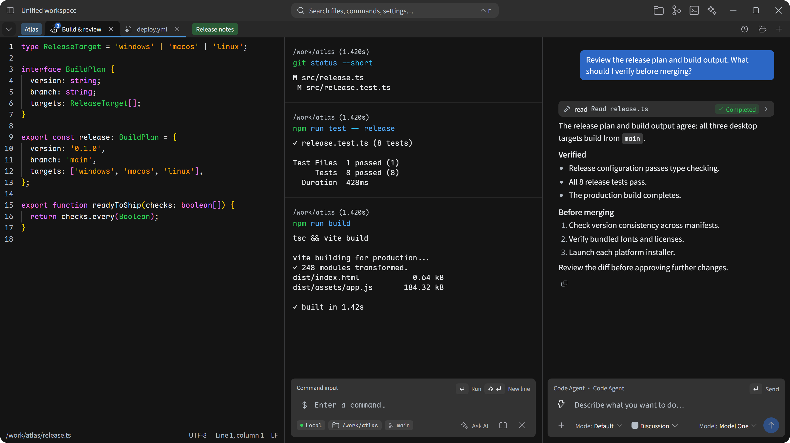</a>

## Arrange the workspace around your work

Development usually takes more than a terminal. There is code to read, output to compare, a remote environment to inspect and context to share with an agent. Vrykell keeps those resources in one workspace: each tab can combine different resource types in up to four panes. Running terminals and conversations retain their own state as you switch, move and resize the layout.

### Edit on the left. Build on the right.

Open a project file beside a build or test terminal. Change code, run a command and inspect the result without leaving the task. Add an agent pane when you need help reading relevant files and command output.

The editor provides syntax highlighting, find and replace, encoding selection, read-only states and save-conflict feedback, alongside Markdown preview and Git comparisons. Command blocks retain the directory, branch, duration and exit status. Reference a failed block directly in the next conversation.

<a href="docs/images/scenario-build-en.png">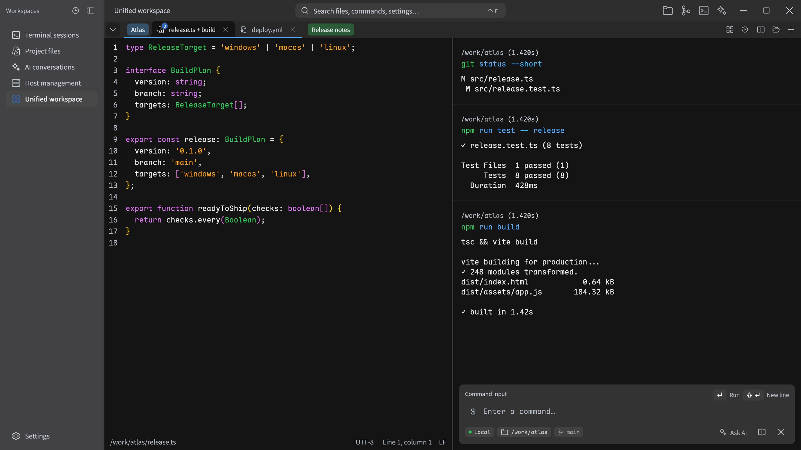</a>

### SSH on the left. AI on the right.

Connect to a server, inspect service status, disk space or deployment logs, and discuss the next step beside the session. Share actual terminal output to help the agent organize an investigation, inspect configuration or prepare a rollback plan. Tool execution and writes follow your permission policy, with inspectable operation records.

Host management covers password and key authentication, host-key confirmation and port forwarding. Direct connections support SFTP browsing, uploads, downloads and remote editing. Jump hosts work for interactive terminals; file browsing and resource monitoring through them remain limited.

<a href="docs/images/scenario-remote-en.png">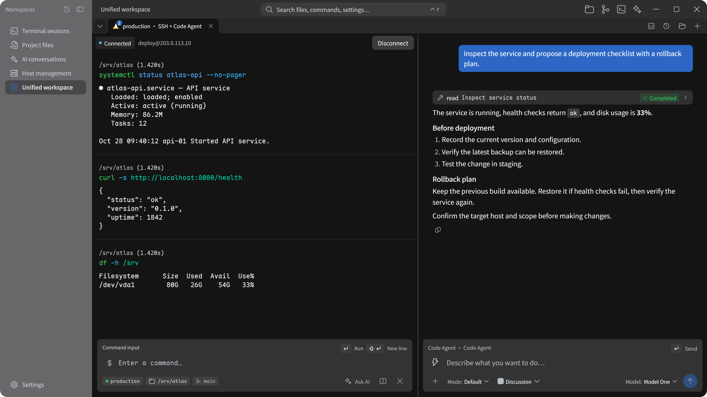</a>

### Give your agent a complete workbench

Start a built-in AI conversation or connect an external agent through ACP. Keep an execution terminal in one pane and planning, tool calls and replies in another. Open a file or diff when you need to inspect a change before continuing.

Inline AI, side conversations and independent sessions support different ways of working. Tool calls, approvals, retries and session state have dedicated interfaces. Skills, MCP and local memory extend context and tools. Specific capabilities depend on the model service or agent you configure.

### Make everyday tasks easier to follow

| Your task | A workspace arrangement |
| --- | --- |
| Debug an API | Run the service in one terminal, send requests in another, and keep the handler or logs nearby. |
| Investigate a failed build | Keep the failed command block, ask AI about its output, and open the affected file to check the fix. |
| Work across projects | Organize tabs into named, colored groups and collapse groups you are not using. |
| Check a remote change | Place remote files or AI beside SSH, then confirm the target before acting. |
| Review an agent's work | Compare tool records, file contents and Git diffs before continuing. |
| Repeat a workflow | Search, favorite, group and rerun commands from history. |

## Dedicated workspaces for focused tasks

The unified workspace brings different resources together. When you want to focus on one kind of work, switch to its dedicated workspace. Tabs, history and live content keep their own places, ready to be combined again when the task calls for it.

### Terminal: make commands and results easier to revisit

Keep local shells and SSH sessions in their own tabs. Command blocks bring the command, working directory, output and status together. Search, favorite and rerun history, or complete a command from earlier entries. Open the AI sidebar to discuss a result; switch to the classic terminal view for full-screen tools and traditional interactive sessions.

<a href="docs/images/single-terminal-en.png">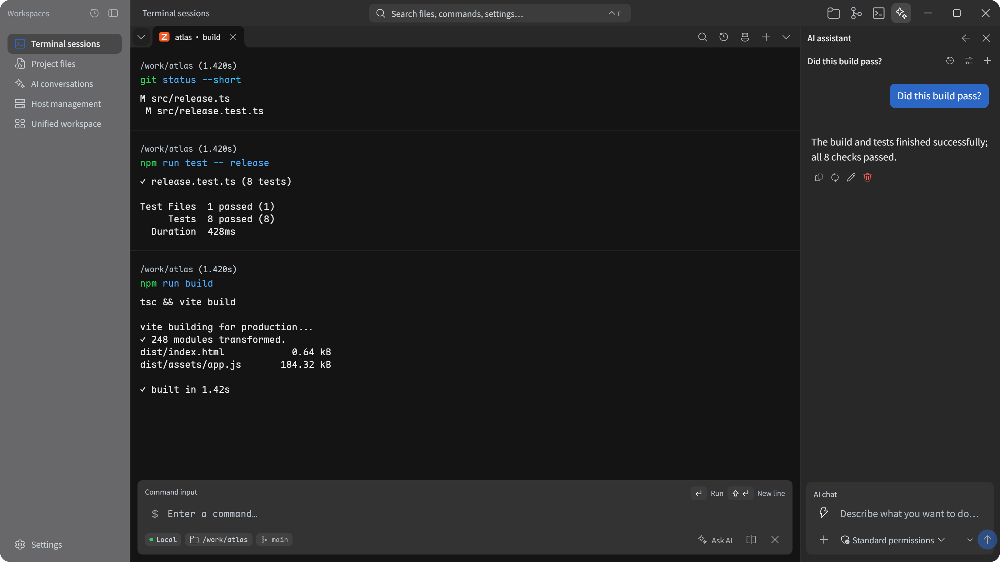</a>

### Editor: keep files, previews and diffs close

Open local or remote files with syntax highlighting, find and replace, and Markdown preview. Organize files in tabs and inspect Git status and comparisons. Read-only states and save conflicts are presented before you overwrite unconfirmed changes.

<a href="docs/images/single-editor-en.png">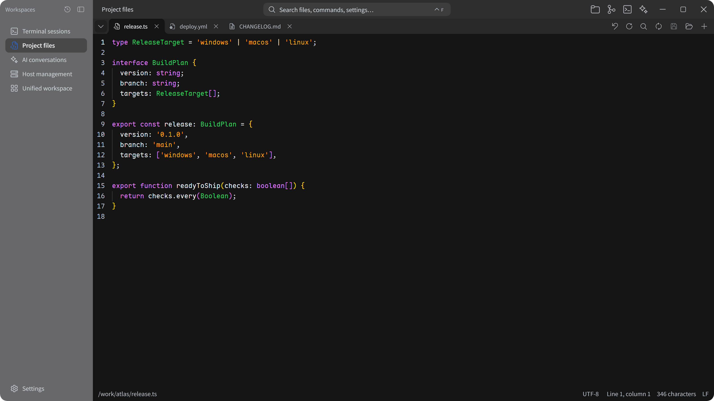</a>

### Hosts: from connecting to daily maintenance

Manage connections in a list or as cards and find a target by name, group or tag. A saved host can open a terminal, browse remote files, manage transfers or configure forwarding. Direct connections can also show resource status on demand.

<a href="docs/images/single-hosts-en.png">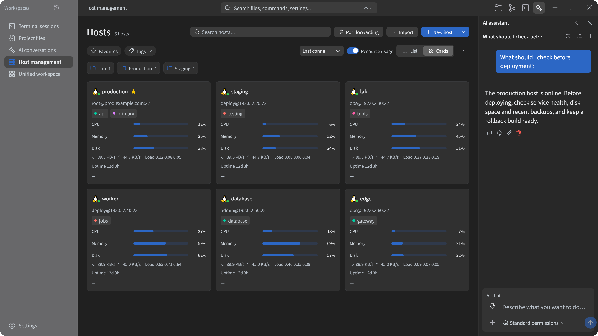</a>

### AI: discuss and share context before acting

Ask a question in a plain conversation or attach text, files and images; image input requires a capable model. When a task needs execution, select its terminal environment and review tool calls and permission requests. Built-in conversations and external agents can be kept separately for each task.

<a href="docs/images/single-ai-en.png">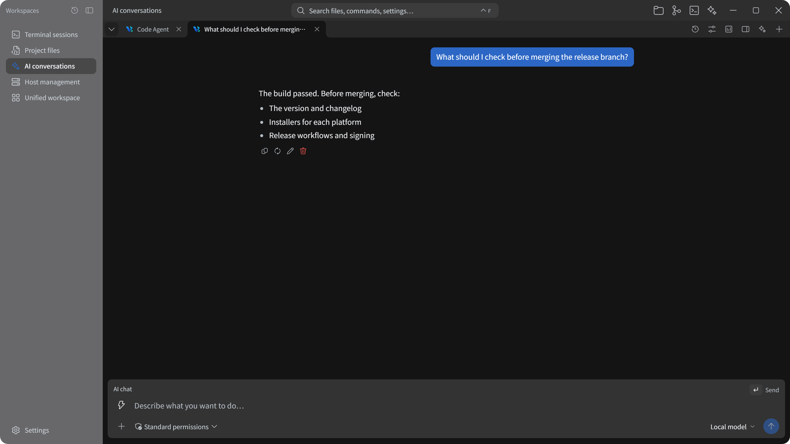</a>

## A workbench in your own colors

Choose from ten built-in dark and light schemes, including the original defaults. The interface, editor and terminal change together. Dark and light choices are remembered separately and can follow your system appearance. Independent fonts, sizes and wallpaper settings help make the workspace your own.

<a href="docs/images/theme-settings-en.png">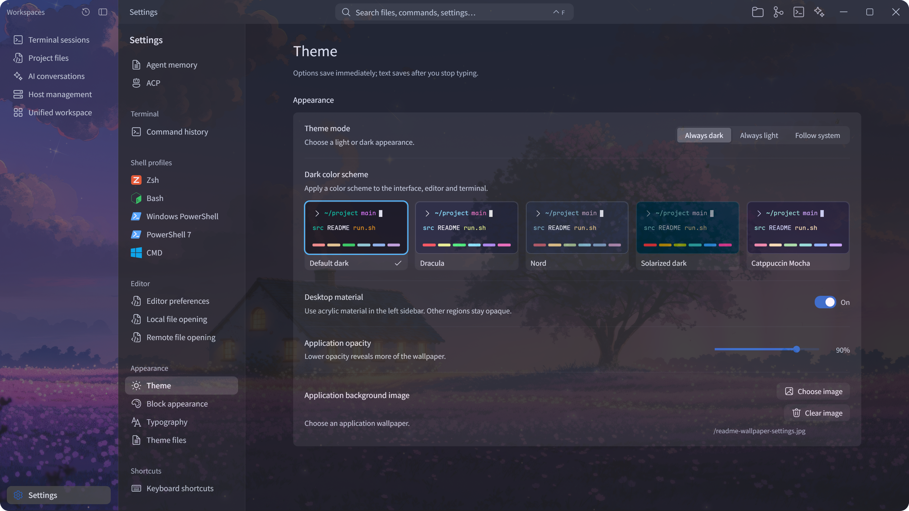</a>

<a href="docs/images/theme-light-en.png">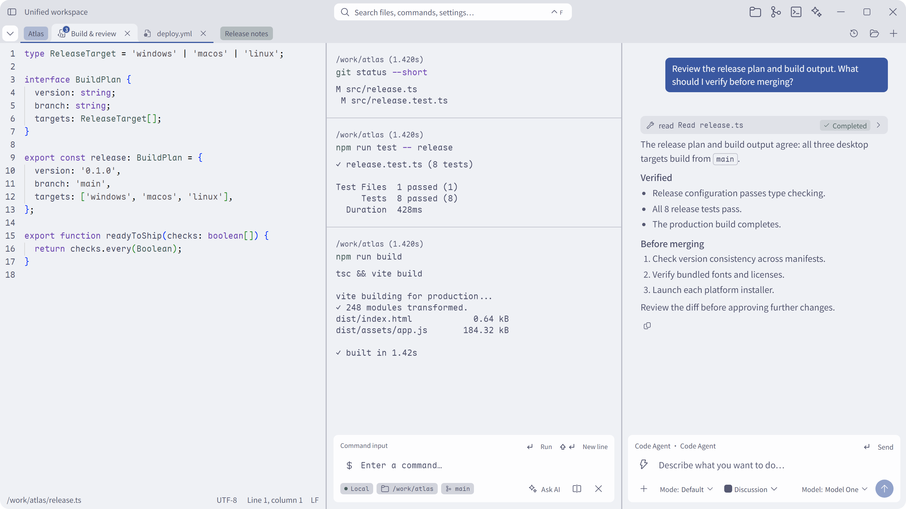</a>

<a href="docs/images/theme-nord-en.png">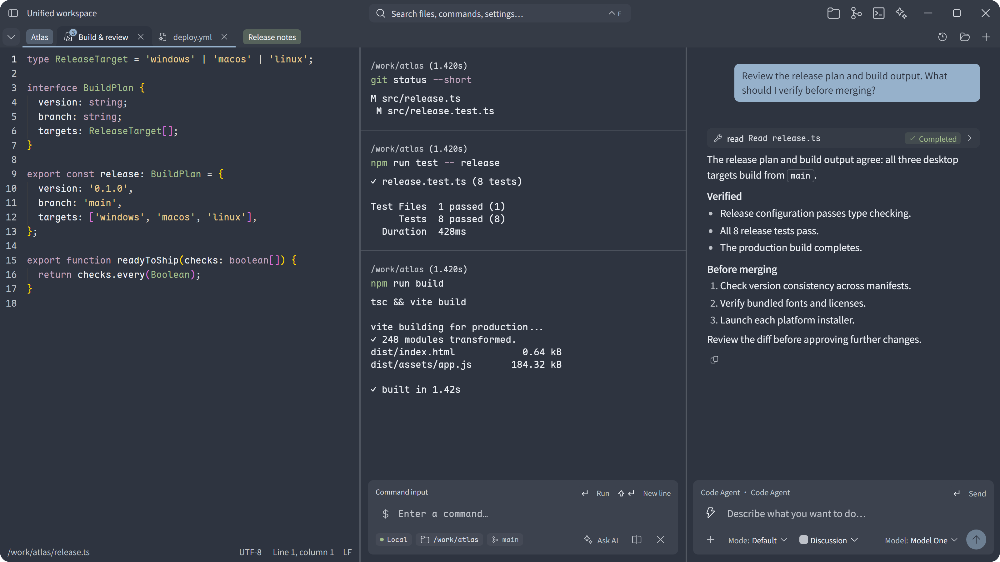</a>

Choose a local wallpaper and adjust application opacity to bring a background into the terminal or settings. Fonts, schemes and wallpaper are stored independently, so the workspace can retain your own style.

## Capabilities

| Area | Available features |
| --- | --- |
| Terminal | Local shells, SSH, command blocks, classic terminal view, TUI and alternate screens, IME, copy and search. |
| Workspace | Mixed resource tabs, up to four panes, drag ordering, named groups, group colors, collapsing, pane focus and resizing. |
| AI and agents | Multiple models, bring your own key, streaming, command-output references, tool permissions, ACP, skills, MCP and local memory. |
| Code and files | Local and remote browsing, transfer, built-in editor, Markdown preview, Git status and comparisons. |
| Remote connections | Host profiles, password and key authentication, host-key verification, port forwarding and resource monitoring over direct connections. |
| History and search | Command and session history, favorites, grouping, filters and workspace layout restoration. |
| Appearance and input | Ten built-in dark/light color schemes with system appearance support; application/terminal/editor typography, bundled fonts, shortcuts and Chinese/English interfaces. |

Screenshots use the application UI with a sample project and simulated session data. Click an image for its original resolution.

## Get started

Version **0.1.0** is in early development. Run from source, or obtain installers from a successful `main` workflow as described in the [build guide](docs/en/ci.md). There is no fixed stable-release schedule yet.

Install Node.js **22.12+**, a stable Rust toolchain and your platform's [desktop build prerequisites](https://v2.tauri.app/start/prerequisites/).

```bash
git clone https://github.com/Vrykell/Vrykell.git
cd Vrykell
npm ci
npm run tauri dev
```

For frontend-only development, use `npm run dev` on port `1420`. To build an installer, run `npm run tauri -- build`.

<details>
<summary>Platform preparation</summary>

- **Windows**: C++ build tools, the system WebView2 runtime and the desktop SDK needed by the native context menu.
- **macOS**: command-line development tools, Perl and Make. Native SSH dependencies build from source without a separately installed system cryptography library.
- **Linux**: desktop WebView, GUI and application-indicator development dependencies; see the prerequisites above.

</details>

### Connect a model or agent

Add a model service URL, key and model in settings, then select the active configuration. Built-in conversations support native Messages and generation interfaces and OpenAI-compatible endpoints, including compatible local model services. Requests go directly to the service you configure; the application does not provide a model relay.

Configure an external agent's startup command and working directory in ACP settings. Review tool permissions before starting. With remote targets, also check the selected execution terminal and directory so the execution environment is clear.

### Current boundaries

- Sessions and composition layouts can enter history. Unsaved editor drafts and file browsing state are not a reliable way to preserve work across restarts.
- Model services, external agents and remote hosts require your configuration. Their costs and capabilities depend on the services you choose.
- Jump-host support focuses on interactive terminals; browsing and monitoring do not cover the same connection paths yet.
- Distribution signing and notarization are not configured. See [CI and packages](docs/en/ci.md).

## Build it with us

Issues, use cases, documentation, translations, tests and code contributions are welcome. A first contribution can be a reproducible bug report, a missing explanation or a regression test. Open an issue before a substantial feature to agree on its use case, boundaries and behavior.

**Contribution PRs target `dev`.** Maintainers use `main` for integration and version builds. Read the [contributing guide](CONTRIBUTING.en.md) for branch naming, setup, checks and review.

```bash
npx tsc --noEmit
npm run test
npm run check:architecture
```

Interactive changes also need matching browser regressions, and backend changes need native tests. Commit messages use English and the agreed prefixes. Commit, PR and issue templates are included.

## Community

Join the community group to share ideas, ask questions and follow the project. Group number: **1130135497**.

<a href="docs/images/community-group.jpg">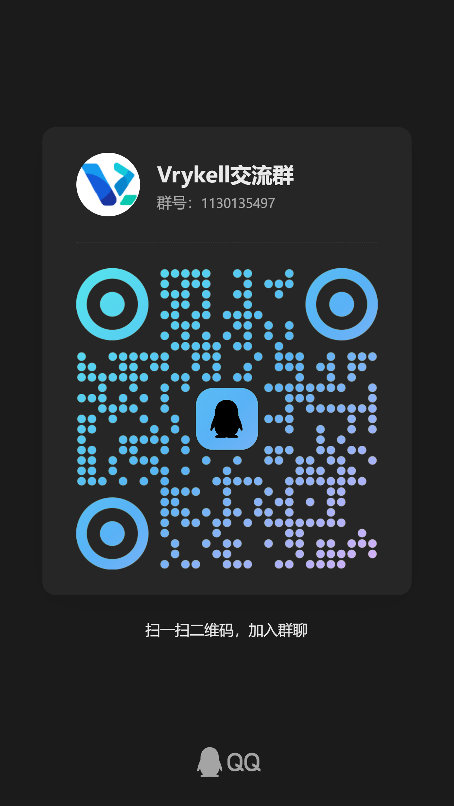</a>

## Read more

[Features and regression checklist](docs/en/feature-spec.md) · [Architecture](docs/en/architecture.md) · [Workspace compositions](docs/en/workspace-compositions.md) · [Development rules](docs/en/development-rules.md) · [Security model](docs/en/security-model.md) · [CI and packages](docs/en/ci.md) · [Known pitfalls](docs/en/pitfalls.md)

## License

Original code and documentation use the [Apache License, Version 2.0](LICENSE), except where otherwise stated. Copyright 2026 Vrykell contributors.

Third-party software, fonts and icons retain their own terms and attribution. See [NOTICE](NOTICE), [third-party notices](THIRD_PARTY_NOTICES.md) and the [licensing guide](docs/en/licensing.md). Unless explicitly stated otherwise, contributions submitted for inclusion are offered under the project license.
