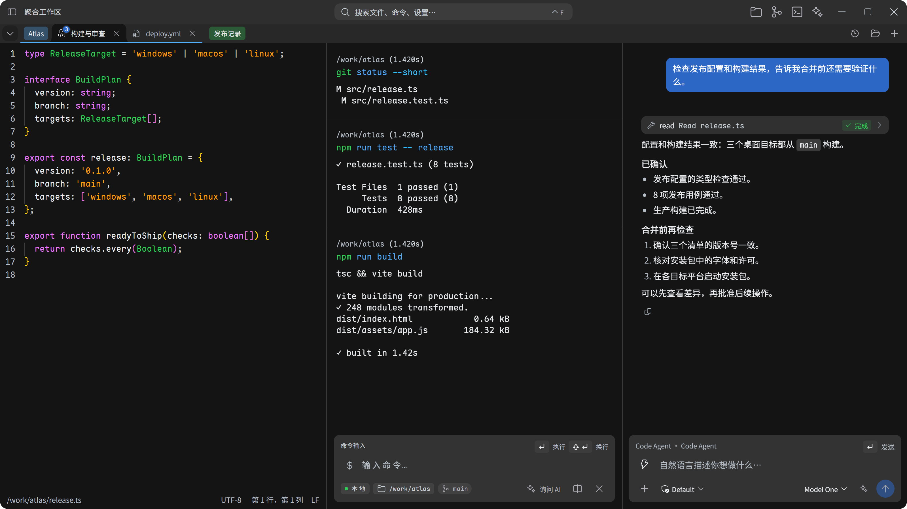
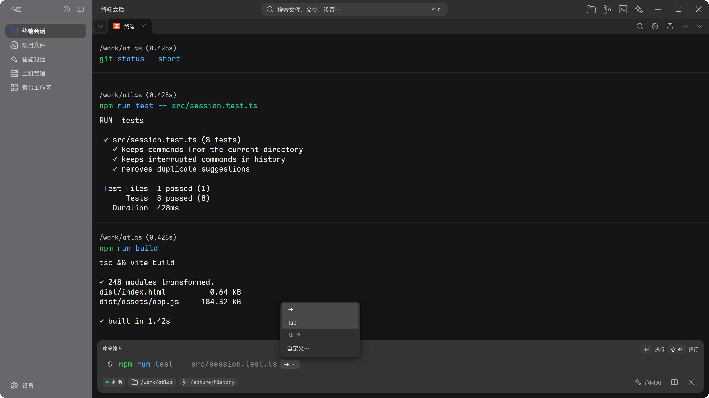
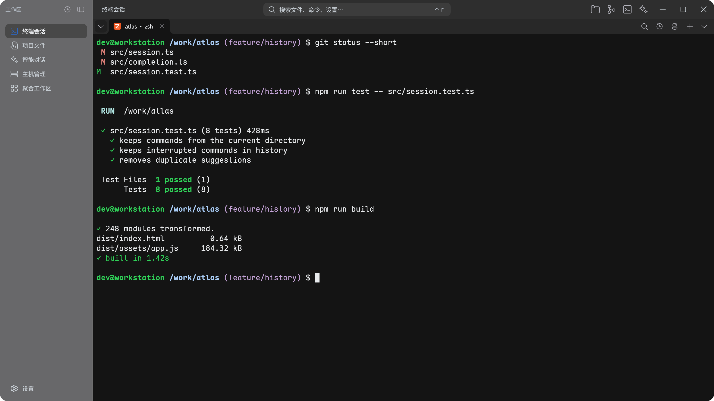
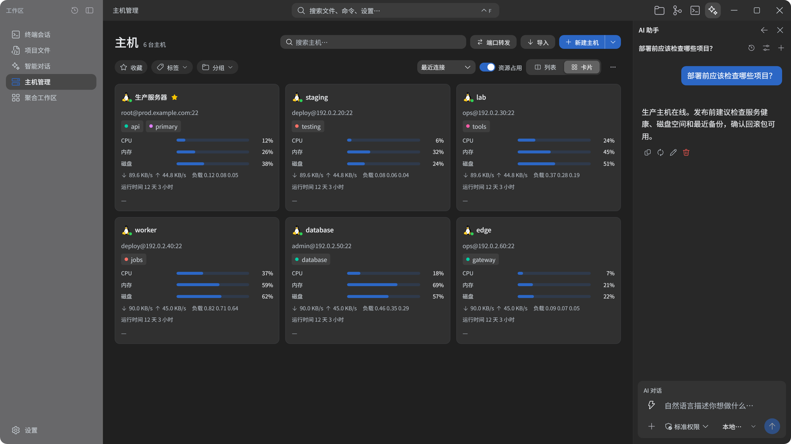
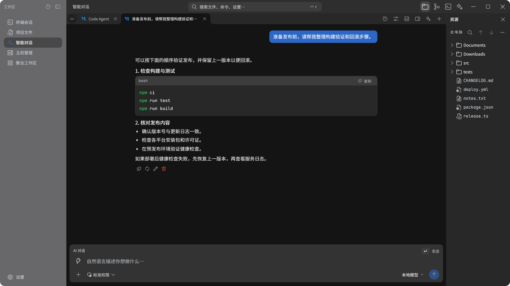
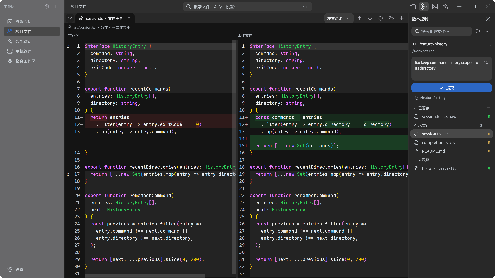
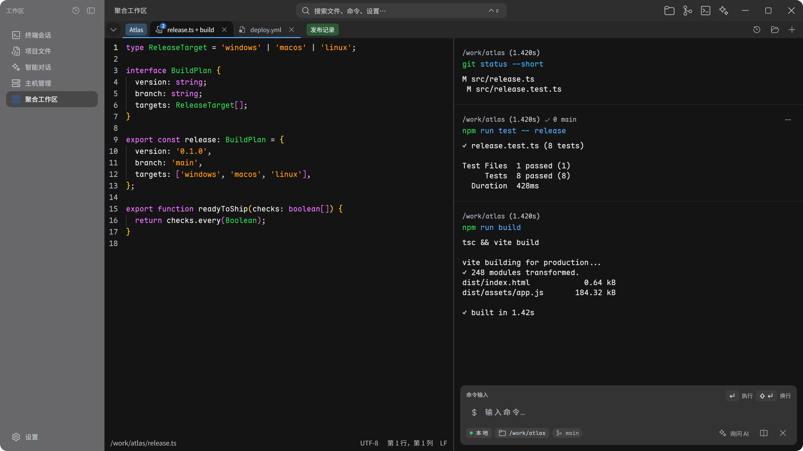
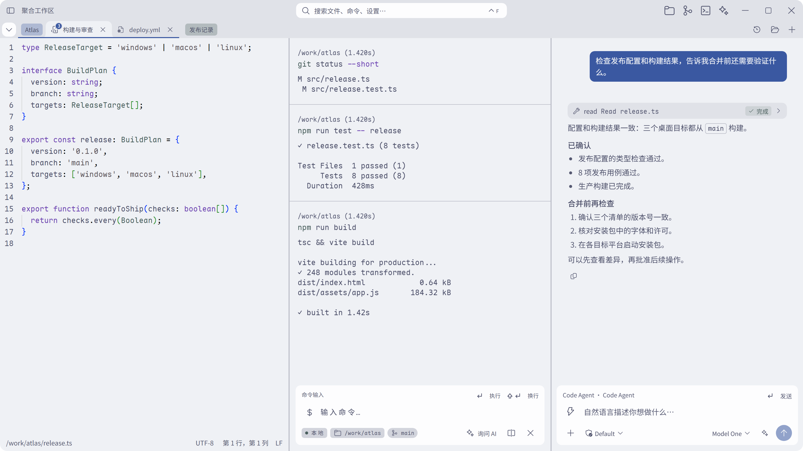
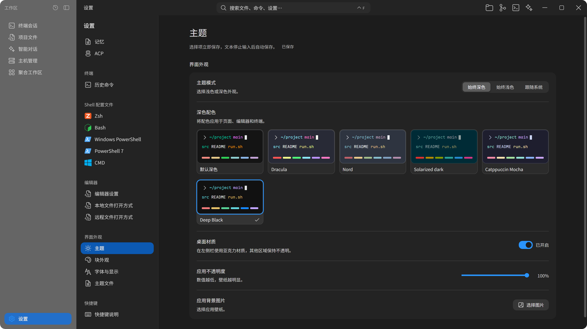
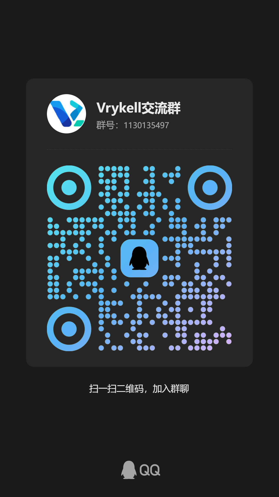

<div align="center">


# Vrykell

**面向开发与远程运维的终端工作台。**

保留命令执行的上下文，管理 SSH 连接与服务，在一个客户端中接入多个 ACP Agent，并明确选择执行目标。

**[下载](#下载)** &nbsp; · &nbsp; [工作方式](#工作方式) &nbsp; · &nbsp; [从源码运行](#从源码运行) &nbsp; · &nbsp; [English](README.md)

<p>
  <a href="LICENSE"></a>
  
</p>

</div>

<a href="docs/images/hero-workspace-zh.png"></a>

Vrykell 围绕真实的 Shell 会话组织开发与远程工作。每条命令可以保留执行目录、输出和结果；文件与差异对应当前操作的环境；对话则可以明确选择其中一个终端作为执行目标。

工作流程从**运行命令，延伸到理解结果、修改文件和审查变更**。你可以把失败命令的上下文带入对话，在 Agent 工作时观察它使用的终端，再检查实际产生的差异，决定哪些内容进入提交。

## 工作方式

### 1. 按单次执行回看命令与结果

块模式将命令与工作目录、分支、输出、耗时和退出状态放在一起。继续工作之后，仍能找到那次失败的构建及其结果。可以在命令所属终端中重新运行，分别复制命令或输出，也可以把快照放进对话，检查后再发送。

终端支持三种工作状态：

| 状态 | 用途 |
| --- | --- |
| 命令块 | 按单次执行检查命令，回看对应的上下文和结果。 |
| 经典终端 | 使用连续终端画面，也适用于没有块模式集成的 Shell。 |
| 全屏交互 | 运行交互编辑器、分页器或监控程序，退出后回到原来的视图。 |

历史建议和本地路径补全无需模型密钥。Tab 补全结合内置候选、所支持的 Shell 补全，以及当前本地或 SSH 目录中的路径，支持引号和带空格的名称。可选的 AI 补全在没有本地建议时调用所配置的模型。历史命令支持搜索、分组和收藏。

<a href="docs/images/feature-completion-zh.png"></a>

<a href="docs/images/feature-classic-zh.png"></a>

<p align="center"><sub>经典模式：Shell 提示符与输出保留在连续的终端画面中。</sub></p>

### 2. 从 SSH 连接延伸到远程操作

保存的主机配置包含认证方式、跳板连接、代理选择、转发规则、环境变量和备注。通过分组、标签和收藏组织主机，也可以导入已有连接配置，减少重复录入。

| 能力 | 实际行为 |
| --- | --- |
| 连接路由与主机信任 | 已保存的跳板配置可以组成最多八跳的路由，每一跳分别认证并校验主机密钥。标准路由覆盖文件浏览、资源监控和托管转发。 |
| 交互认证 | 服务认证支持密码、私钥口令，以及 MFA 等多轮服务器挑战。文件与监控可以复用已认证的目标连接；挑战答案不会缓存用于重连。 |
| 文件与传输 | 通过 SFTP 浏览和管理文件，上传下载任务有独立传输列表。 |
| 资源状态 | 在会话旁查看 CPU、内存、根磁盘使用率和网络流量，按需采集。 |
| 托管转发 | 独立启停本地、远程和动态转发规则；关闭终端本身不会停止托管转发。 |

终端接入与服务接入各有前提。只提供交互菜单的网关，并不自动提供 SFTP、监控或转发能力。传输和托管转发也需要独立认证，不复用保留的交互认证服务连接。具体连接路径和生命周期见[连接配置说明](docs/zh/ssh-profiles.md)。

<a href="docs/images/single-hosts-zh.png"></a>

### 3. 给 Agent 一个明确的执行环境

对话可以独立使用，也可以连接选定的本地或 SSH 终端。直接附上命令块、文本、文件或图片，将实际问题带入对话。图片输入取决于模型能力。应用提供的执行工具遵循以下规则：

- **执行目标固定。** 每轮执行使用开始时选定的终端，切换工作区焦点不会改变目标；目标断开时会报错。选择远程目标后，应用提供的本地文件工具不可用。
- **确认结束后再继续。** 命令执行等待所支持的 Shell 完成信号，在可获取时返回输出和退出状态。屏幕暂时没有输出不代表命令结束；无法确认结束时，后续排队命令会停止，等待检查终端。
- **工具访问可检查。** 工具支持允许、询问和拒绝策略，以及会话授权和敏感操作的原生确认。调用、结果和审批结论保留在对话中。

内置 Agent 使用你配置的模型服务，支持技能、MCP 工具和按范围管理的本地记忆；也可以通过 ACP 接入外部 Agent。外部会话可使用应用工具，复用同一套实现与权限流程。外部 Agent 自带的独立工具由该 Agent 管理。详见[外部会话的应用工具](docs/zh/application-tools.md)和[安全模型](docs/zh/security-model.md)。

#### 一个客户端，连接 20+ Agent 生态

通过预设或自定义本地命令，接入拥有 20+ Agent 选择的 [ACP 生态](https://github.com/agentclientprotocol/registry)。内置 11 个启动预设，包括 Claude Code、Codex、Gemini CLI、OpenCode、Qwen Code、Cursor、OpenClaw、Kiro CLI、Kimi CLI、Goose 和 Pi；其他兼容 Agent 可自行配置命令、参数、环境变量和项目目录。

| 在同一个客户端中 | 各自保留的状态 |
| --- | --- |
| 多个 Agent 配置与对话标签 | 每个对话保留自己的草稿、项目上下文、流式回复和取消状态。 |
| 主窗格与可停靠的对话侧栏 | 切换 Agent 或移动对话时，保留已连接会话与草稿。 |
| 模型、模式与会话设置 | 按当前 Agent 实际报告的能力展示控件。 |
| 终端与文件工具 | 明确选择执行目标，在对话中检查应用工具的审批记录。 |

在**设置 → ACP**中添加预设或自定义命令，完成所选 Agent 的安装与认证，再在新建对话时选择项目目录。可用性、认证方式、模型及可选协议能力取决于各 Agent。预设提供启动配置，更广泛的生态以协议目录为参考。

<a href="docs/images/single-ai-zh.png"></a>

### 4. 从执行结果走到变更审查

把源文件和测试终端并排打开，修改后直接运行验证。内置编辑器支持语法高亮、查找替换、Markdown 预览、字符编码和 Vim 按键，并明确处理未保存修改、只读状态和保存冲突。

源码管理面板跟随当前终端或文件，也支持已保存的 SSH 连接；还可以绑定一个终端，在切换焦点后继续查看同一仓库。分别检查已暂存与未暂存差异、处理冲突、按文件暂存，只提交暂存区并保留其他修改。面板支持 fetch、pull、push、分支与标签操作，以及关联工作树浏览。拉取采用快进更新；AI 生成的提交信息保留为草稿，供你审阅。

每个标签最多混排四个终端、文件、差异或对话窗格。移动窗格和切换视图保留原有资源实例，调整布局不会重启终端进程或复制对话。命名分组、窗格放大和可停靠的对话侧栏用于组织不同任务。

远程文件在编辑器中打开的是下载副本，保存不会自动上传。Git 操作使用对应本机或远程主机上安装的 Git。

<a href="docs/images/feature-git-zh.png"></a>

<details>
<summary>布局示例：编辑代码与运行构建</summary>

<a href="docs/images/scenario-build-zh.png"></a>

</details>

## 实现与验证

终端的命令级行为由明确的生命周期驱动。Rust 同步扫描器保持 PTY 输出中 Shell 集成标记的顺序；每个会话的控制器跟踪命令边界，并在命令块、经典模式和全屏交互之间切换。VT/ANSI 解析交给终端引擎，已完成的块输出以 DOM 呈现。详见[架构文档](docs/zh/architecture.md)。

混合布局保存各功能域所拥有资源的引用。移动窗格改变的是位置，进程、文档和对话保留各自的身份。恢复历史时，由对应的资源管理模块解析引用，缺失内容会报错。详见[工作区组合](docs/zh/workspace-compositions.md)。

仓库包含单元、浏览器和原生回归测试，覆盖延迟命令标记、全屏切换、Agent 目标固定、执行结束未确认、权限取消和工作区恢复等场景。独立 SSH 协议检查使用临时回环服务器，验证多跳认证、文件、资源、转发和主机密钥拒绝。[功能清单](docs/zh/feature-spec.md)对应具体行为与验证方式；[CI 文档](docs/zh/ci.md)区分自动检查、按需平台验证和安装包验证。

<details>
<summary>外观：主题、字体与壁纸</summary>

内置十一套配色，覆盖深色与浅色，分别保存选择，也可以跟随系统。界面、编辑器、终端和对话可独立设置字体与字号；内置字体无需另行安装，并支持本地壁纸和应用不透明度设置。

<a href="docs/images/theme-light-zh.png"></a>
<a href="docs/images/theme-deep-black-zh.png"></a>

</details>

截图来自应用界面，使用示例项目与模拟会话数据，跟随开发分支，可能领先于已发布安装包。

## 下载

当前稳定版：**0.1.3**。

| 平台 | 安装包 |
| --- | --- |
| Windows x64 | [.exe](https://github.com/Vrykell/Vrykell/releases/download/v0.1.3/Vrykell_0.1.3_x64-setup.exe) |
| macOS Apple silicon | [.dmg](https://github.com/Vrykell/Vrykell/releases/download/v0.1.3/Vrykell_0.1.3_aarch64.dmg) |
| macOS Intel | [.dmg](https://github.com/Vrykell/Vrykell/releases/download/v0.1.3/Vrykell_0.1.3_x64.dmg) |
| Linux amd64 | [.deb](https://github.com/Vrykell/Vrykell/releases/download/v0.1.3/Vrykell_0.1.3_amd64.deb) · [.AppImage](https://github.com/Vrykell/Vrykell/releases/download/v0.1.3/Vrykell_0.1.3_amd64.AppImage) |

[全部版本](https://github.com/Vrykell/Vrykell/releases) · [发布说明](https://github.com/Vrykell/Vrykell/releases/tag/v0.1.3)

发布说明记录安装包校验和、精确源码提交与验证覆盖。更新签名用于验证更新载荷，不能替代操作系统的分发签名或公证。上文能力描述跟随开发分支；安装包发布之后的改动需要构建当前源码。

### 当前边界

- **持久化：** 支持会话历史和组合布局；未保存的编辑器草稿、文件浏览状态不能作为可靠的跨重启保存方式，恢复布局也不会续接过去正在运行的进程。
- **远程工作：** 编辑器副本不会自动同步回远端；仅提供交互功能的网关未必开放服务通道，传输和托管转发有独立认证要求。
- **模型与外部 Agent：** 需要自行提供和配置。请求直接发往所配置的模型服务，不经过应用运营的中转；可用性、能力和费用取决于所选服务或 Agent。
- **执行权限：** 终端以当前用户权限运行。应用工具审批约束经由这些工具发起的操作，不隔离外部 Agent 进程及其自行配置的工具。详见[安全模型](docs/zh/security-model.md)和[安全政策](SECURITY.zh-CN.md)。

<a id="开始使用"></a>

## 从源码运行

准备 Node.js **22.12+**、Rust 稳定工具链，以及对应平台的[桌面构建依赖](https://v2.tauri.app/start/prerequisites/)。

```bash
git clone https://github.com/Vrykell/Vrykell.git
cd Vrykell
npm ci
npm run tauri dev
```

只开发前端时使用 `npm run dev`，默认端口为 `1420`。需要安装包时运行 `npm run tauri -- build`。

<details>
<summary>平台准备</summary>

- **Windows**：需要 C++ 构建工具、Perl、系统 WebView2 运行时，以及原生上下文菜单构建所需的桌面 SDK。SSH 原生加密库从源码构建，无需单独安装运行时库。
- **macOS**：需要命令行开发工具、Perl 和 Make。SSH 相关原生库由依赖工具链从源码构建，无需单独安装系统加密库。
- **Linux**：安装桌面 WebView、图形界面及应用指示器等系统开发依赖，具体见上方构建依赖链接。

</details>

使用内置 Agent 时，在设置中添加模型服务地址、密钥和模型，再选择当前配置。支持原生 Messages、生成接口和兼容的聊天补全接口，也可以连接提供兼容接口的本地模型服务。

使用外部 Agent 时，在 ACP 设置中添加启动命令。项目文件夹留空时会在应用私有的 ACP 工作区下新建目录；也可以显式选择项目文件夹。输入区左下角的添加附件支持文本附件，并在代理声明图片能力后支持图片。需要调用应用的终端工具时，选择执行终端。

## 参与贡献

**贡献 PR 以 `dev` 为目标分支。** `main` 用于维护者集成和版本构建。开发环境、分支命名、检查与评审要求见[贡献指南](CONTRIBUTING.md)。报告问题请附上复现步骤和平台信息；较大的功能请先开 Issue 讨论。

```bash
npx tsc --noEmit
npm run test
npm run check:architecture
```

交互改动还需对应浏览器回归测试，后端改动需运行原生测试。提交信息使用英文和约定前缀。

## 社区与文档

交流群：**1130135497**。欢迎分享工作流程、交流问题和讨论项目。

Discord：[加入 Vrykell 社区](https://discord.gg/ZqKPd5DW)。

<details>
<summary>交流群二维码</summary>

<a href="docs/images/community-group.jpg"></a>

</details>

- [功能与回归清单](docs/zh/feature-spec.md)
- [架构](docs/zh/architecture.md)
- [连接配置与转发](docs/zh/ssh-profiles.md)
- [外部 Agent 的应用工具](docs/zh/application-tools.md)
- [工作区组合](docs/zh/workspace-compositions.md)
- [安全模型](docs/zh/security-model.md)
- [开发规则](docs/zh/development-rules.md)
- [CI 与安装包](docs/zh/ci.md)

## 许可

原创代码与文档采用 [Apache License 2.0](LICENSE)，另有声明的文件除外。Copyright 2026 Vrykell contributors。

第三方软件、字体和图标保留各自的许可与署名，详见 [NOTICE](NOTICE)、[第三方声明](THIRD_PARTY_NOTICES.md) 和[许可说明](docs/zh/licensing.md)。提交用于纳入本项目的贡献，除非明确另有说明，按项目许可提供。
