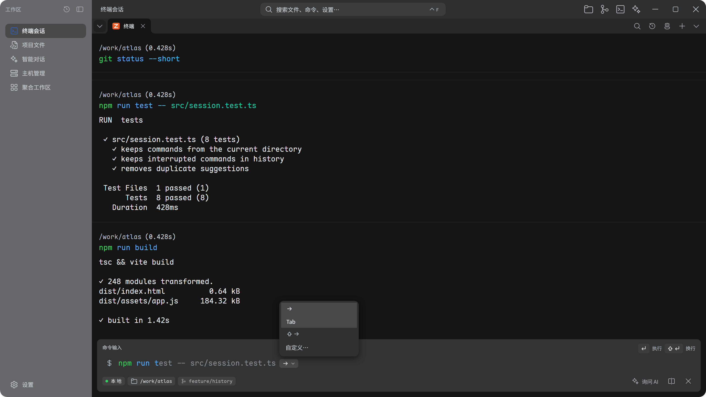
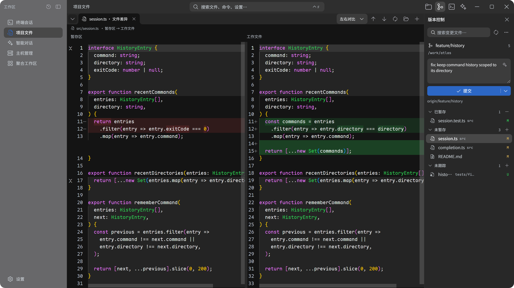
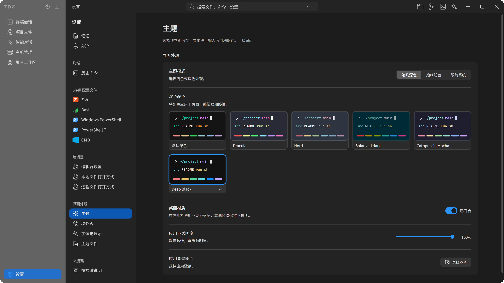

<div align="center">


# Vrykell

### 面向 AI 协作的终端工作区。

Vrykell 是一款面向开发者和运维人员的跨平台终端工作空间，将终端、文件管理、代码编辑、Git 和 AI 助手整合在一个桌面应用中，减少开发和远程运维时在多个工具之间切换的成本。

[下载 Beta](#下载) · [主要功能](#主要功能) · [使用场景](#使用场景) · [从源码运行](#从源码运行) · [参与贡献](CONTRIBUTING.md) · [English](README.md)

<p>
  <a href="LICENSE"></a>
  
</p>

</div>

<a href="docs/images/hero-workspace-zh.png"></a>

## 下载

最新预览版为 **0.1.0 Beta 3**。日常使用前可先查看[当前边界](#当前边界)。截图和功能介绍跟随开发分支，可能领先于已发布的安装包。

| 平台 | 安装包 |
| --- | --- |
| Windows x64 | [.exe](https://github.com/Vrykell/Vrykell/releases/download/v0.1.0-beta.3/Vrykell_0.1.0_x64-setup.exe) |
| macOS Apple silicon | [.dmg](https://github.com/Vrykell/Vrykell/releases/download/v0.1.0-beta.3/Vrykell_0.1.0_aarch64.dmg) |
| macOS Intel | [.dmg](https://github.com/Vrykell/Vrykell/releases/download/v0.1.0-beta.3/Vrykell_0.1.0_x64.dmg) |
| Linux amd64 | [.deb](https://github.com/Vrykell/Vrykell/releases/download/v0.1.0-beta.3/Vrykell_0.1.0_amd64.deb) · [.AppImage](https://github.com/Vrykell/Vrykell/releases/download/v0.1.0-beta.3/Vrykell_0.1.0_amd64.AppImage) |

[全部版本与发布说明](https://github.com/Vrykell/Vrykell/releases) · [构建说明](docs/zh/ci.md)

[Beta 3 发布说明](https://github.com/Vrykell/Vrykell/releases/tag/v0.1.0-beta.3) 记录安装包校验和、源码提交与验证边界。安装包仍未签名；如需后续修复请构建当前源码。报告漏洞前请阅读[安全政策](SECURITY.zh-CN.md)。

## 主要功能

- **[终端与命令补全](#终端与命令补全)**：命令块、经典模式、历史建议、Shell 与路径补全。
- **[文件与编辑器](#文件与编辑器)**：本地与 SFTP 文件浏览、传输、编辑器标签及 Markdown 预览。
- **[Git](#git)**：差异、暂存、提交、分支与远程操作。
- **[SSH](#ssh)**：主机管理、认证、端口转发与资源状态。
- **[AI 与 Agent](#ai-与-agent)**：自带模型、引用输出或图片、接入外部 Agent。
- **[工作区布局](#使用场景)**：每个标签最多四个混合窗格，支持标签分组和对话侧栏。

### 终端与命令补全

经典模式保留连续终端画面；块模式把命令与输出、工作目录、分支、耗时和退出状态放在一起。全屏程序使用交互终端画面。历史命令可以搜索、收藏、分组和重新运行。

输入时显示历史建议。本地匹配与路径补全不需要模型密钥；可选的 AI 补全会在没有本地建议时调用所配置的模型。Tab 补全结合内置建议、所支持的 Shell 补全和当前本地或 SSH 目录中的路径，支持引号和带空格的名称。

用 `Tab`、`Shift+Tab` 切换候选，按 `Esc` 恢复原始输入；接受建议的快捷键可以自定义。

<a href="docs/images/feature-completion-zh.png"></a>

<details>
<summary>终端工作区与 AI 侧栏</summary>

<a href="docs/images/single-terminal-zh.png"></a>

</details>

### 文件与编辑器

浏览本地目录或 SFTP 远程文件，支持新建、重命名、复制、移动、删除和多选。上传下载有独立传输列表，文件可以用内置编辑器或指定的外部程序打开。

编辑器支持语法高亮、查找替换、Markdown 预览、字符编码和 Vim 按键。多个文件以标签组织，只读状态、未保存修改和保存冲突会在覆盖前提示。选择内置编辑器时，不支持的文件类型交给系统默认应用打开；远程文件会先下载副本，副本修改不会自动同步回去。

<details>
<summary>项目文件与编辑器</summary>

<a href="docs/images/single-editor-zh.png"></a>

</details>

### Git

源码管理面板跟随当前终端或文件，也支持已保存的 SSH 连接。使用前需要在本机或远程主机安装 Git。

- 按冲突、已暂存、未暂存和未跟踪查看文件，支持列表和树状视图。可以打开差异、暂存、取消暂存，以及确认后丢弃修改。
- 填写提交信息并提交；也可以让 AI 起草提交信息，再自行检查。
- 支持 fetch、pull、push，以及创建、切换、重命名和删除分支、合并、变基和标签管理。
- 浏览关联工作树，切换面板查看的仓库。

一次常见的检查流程是：**查看差异 → 暂存需要的文件 → 核对提交信息 → 提交 → 推送**。其他操作仍可直接在终端运行。

<a href="docs/images/feature-git-zh.png"></a>

### SSH

用列表或卡片管理主机，按名称、分组和标签找到目标。连接支持密码与密钥认证、主机密钥确认和端口转发。直接连接还支持 SFTP 浏览、远程编辑、传输及按需查看资源状态。

<a href="docs/images/single-hosts-zh.png"></a>

### AI 与 Agent

可以直接聊天，也可以附上文本、文件、图片或命令输出。图片输入需要模型支持。执行任务时，先选择目标终端，再在对话中检查工具调用和权限请求。

内置对话支持流式输出、多模型配置、技能、MCP 和本地记忆。外部 Agent 通过 ACP 接入，提供自己的模型和工具。两者都可以放在窗格或侧栏中，按任务分别保留对话。

<a href="docs/images/single-ai-zh.png"></a>

## 使用场景

每个标签最多放四个窗格，可以混排终端、文件、AI 对话和外部 Agent。拖动窗格调整位置，给标签分组、命名和设置颜色，暂时不用的组可以收起。切换标签时，会话和对话继续运行。

### 左边改代码，右边看构建

打开源文件，在旁边保留测试或构建终端。改完代码就运行命令，对照结果检查。需要分析失败输出时，把对应命令块附到对话中。

<a href="docs/images/scenario-build-zh.png"></a>

### 左边 SSH，右边 AI

连接服务器，检查服务状态或部署日志。在旁边保留 AI 对话，讨论输出；交给 Agent 执行前先核对目标终端与目录。

<a href="docs/images/scenario-remote-zh.png"></a>

审查 Agent 的变更时，可以把执行终端留在对话旁边，再打开文件或 Git 差异核对。维护多个项目时，按项目分组收纳会话。

## 主题与字体

内置十一套配色，包含六套深色、五套浅色，以及中性的 Deep Black。原有深浅配色完整保留。深浅选择分别保存，也可以跟随系统。

页面、编辑器、终端和对话可分别设置字体与字号，内置字体无需另行安装。也可以选择本地壁纸，调整应用不透明度。

<a href="docs/images/theme-settings-zh.png"></a>

<a href="docs/images/theme-light-zh.png"></a>
<a href="docs/images/theme-nord-zh.png"></a>

<details>
<summary>Deep Black</summary>

<a href="docs/images/theme-deep-black-zh.png"></a>

</details>

截图来自应用界面，使用示例项目与模拟会话数据；点击可查看原始分辨率。

## 从源码运行

准备 Node.js **22.12+**、Rust 稳定工具链，以及对应平台的[桌面构建依赖](https://v2.tauri.app/start/prerequisites/)。

```bash
git clone https://github.com/Vrykell/Vrykell.git
cd Vrykell
npm ci
npm run tauri dev
```

只开发前端时使用 `npm run dev`，默认端口为 `1420`。需要安装包时运行 `npm run tauri -- build`。

<details>
<summary>平台准备</summary>

- **Windows**：需要 C++ 构建工具、系统 WebView2 运行时，以及原生上下文菜单构建所需的桌面 SDK。
- **macOS**：需要命令行开发工具、Perl 和 Make。SSH 相关原生库由依赖工具链从源码构建，无需单独安装系统加密库。
- **Linux**：安装桌面 WebView、图形界面及应用指示器等系统开发依赖，具体见上方构建依赖链接。

</details>

### 连接模型或 Agent

在设置中添加模型服务的地址、密钥和模型，再选择当前配置。内置对话支持原生 Messages 接口、原生生成接口和 OpenAI 兼容接口，也可连接提供兼容接口的本地模型服务。请求直接发送至你配置的服务，应用不提供模型中转。

外部 Agent 在 ACP 设置中配置启动命令与工作目录。检查工具权限，再开始会话。使用远程目标时，请同时核对执行终端和工作目录，确认实际执行环境。

### 当前边界

- 会话和组合布局可以进入历史；未保存的编辑器草稿、文件浏览状态不能作为可靠的跨重启保存方式。
- 模型服务、外部 Agent 和远程主机需要自行配置；费用与能力取决于所选服务。
- 跳板机目前主要用于交互终端，文件浏览与监控尚未覆盖同等连接路径。
- 分发签名与公证尚未配置，详见[持续集成说明](docs/zh/ci.md)。

## 参与贡献

欢迎提交问题、文档、翻译、测试和代码。报告问题时请附上复现步骤和平台信息；较大的功能改动请先开 Issue，讨论预期行为。

**贡献 PR 以 `dev` 为目标分支。** `main` 用于维护者集成和版本构建。分支命名、开发环境、检查要求和提交流程见[贡献指南](CONTRIBUTING.md)。

```bash
npx tsc --noEmit
npm run test
npm run check:architecture
```

交互改动还需对应端到端测试，后端改动需运行原生测试。提交信息使用英文和约定前缀；仓库提供提交、PR 和 Issue 模板。

## 交流社区

欢迎加入交流群，分享想法、交流问题并关注项目进展。群号：**1130135497**。

<a href="docs/images/community-group.jpg"></a>

## 深入了解

[功能与回归清单](docs/zh/feature-spec.md) · [架构](docs/zh/architecture.md) · [工作区组合](docs/zh/workspace-compositions.md) · [开发规则](docs/zh/development-rules.md) · [安全模型](docs/zh/security-model.md) · [CI 与安装包](docs/zh/ci.md)

## 许可

原创代码与文档采用 [Apache License 2.0](LICENSE)，另有声明的文件除外。Copyright 2026 Vrykell contributors。

第三方软件、字体和图标保留各自的许可与署名，详见 [NOTICE](NOTICE)、[第三方声明](THIRD_PARTY_NOTICES.md) 和[许可说明](docs/zh/licensing.md)。提交用于纳入本项目的贡献，除非明确另有说明，按项目许可提供。
