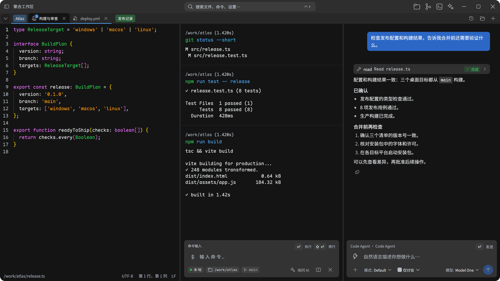
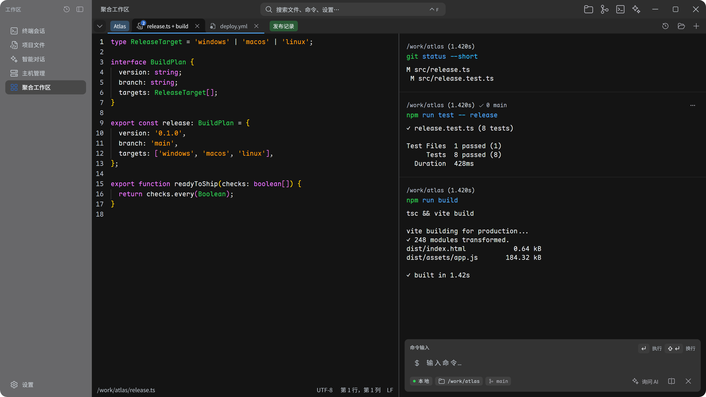
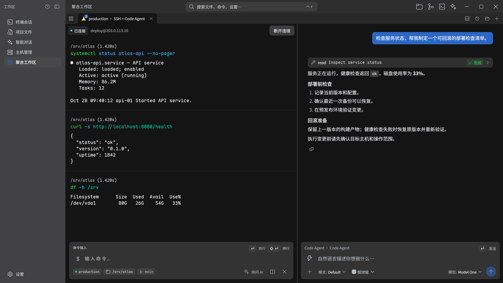
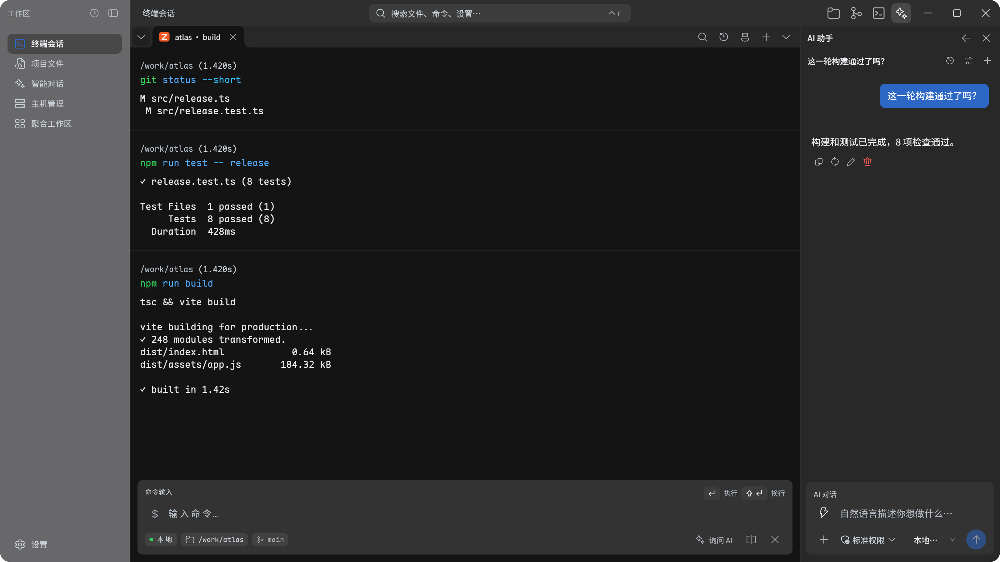
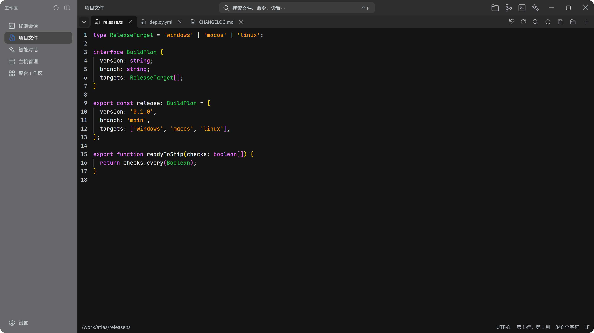
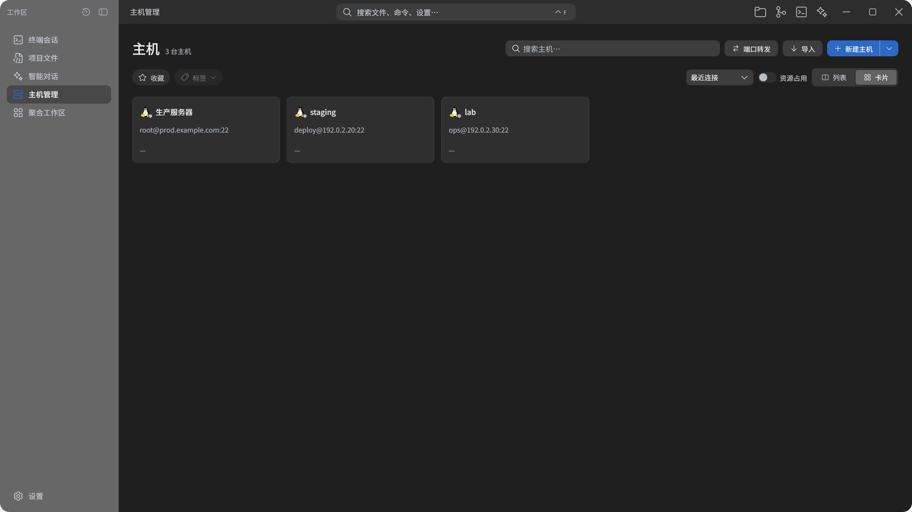
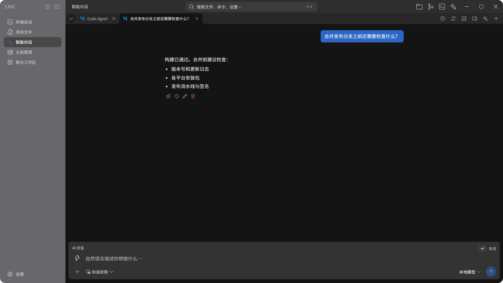
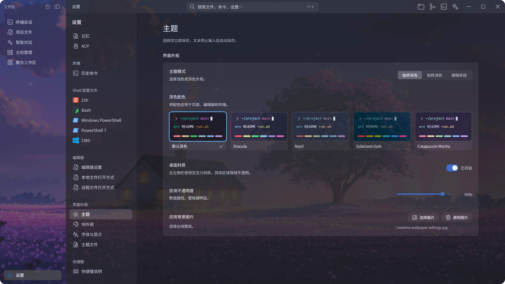
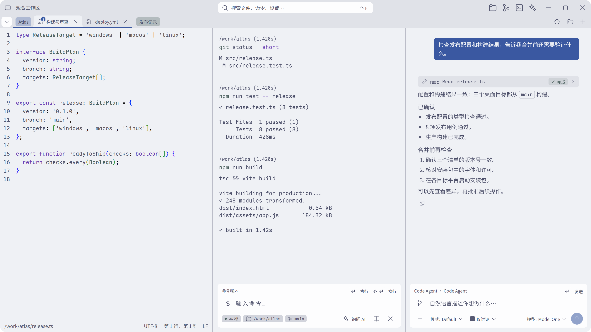
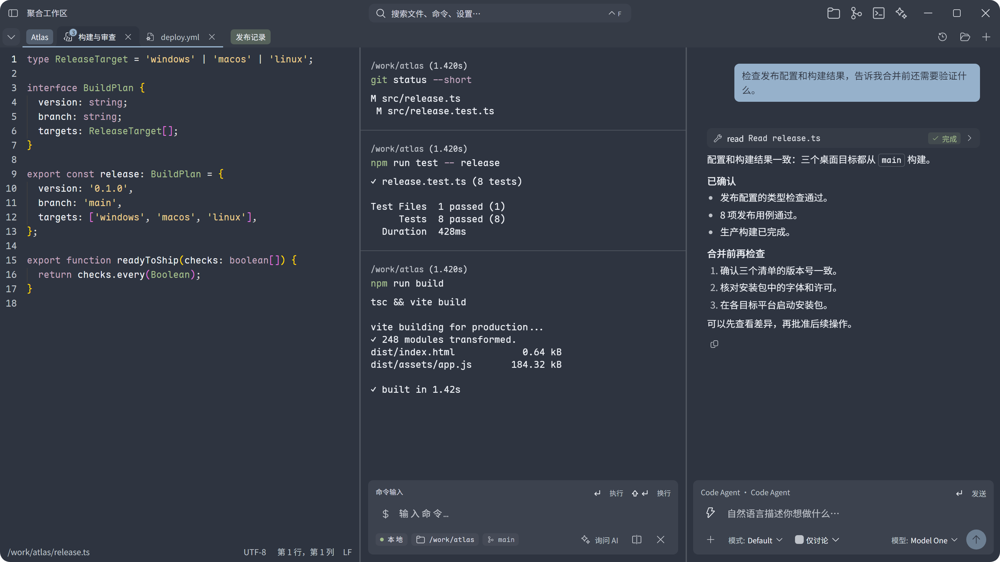

<div align="center">


# Vrykell

### 终端与 AI，并肩工作。

围绕终端构建的桌面工作区。把编辑器、SSH、AI 对话和 Agent 自由组合在同一组标签与分屏中。

[开始使用](#开始使用) · [使用场景](#把工作区摆成你的工作方式) · [参与贡献](CONTRIBUTING.md) · [English](README.md)

<p>
  <a href="LICENSE"></a>
  <a href="https://github.com/Vrykell/Vrykell/actions/workflows/ci.yml"></a>
  
</p>

</div>

<a href="docs/images/hero-workspace-zh.png"></a>

## 把工作区摆成你的工作方式

开发时需要的往往不止一个终端。你还要看代码、对照日志、检查远程环境，再把上下文交给 AI。Vrykell 让这些内容留在同一个工作区：每个标签可以组合不同类型的资源，最多容纳四个窗格；切换、移动和调整布局时，正在运行的终端与会话保持各自的状态。

### 左边改代码，右边看构建

打开项目文件，在旁边保留构建或测试终端。修改代码、运行命令、查看结果，沿着同一条工作流往前走。需要排查时，再加入一个 Agent 窗格，协助阅读相关文件和命令输出。

编辑器支持语法高亮、查找替换、编码选择、只读状态和保存冲突提示，也能查看 Markdown 与 Git 差异。终端输出按命令组织，目录、分支、耗时和退出状态随块保留；构建失败后，可以直接引用那一块继续提问。

<a href="docs/images/scenario-build-zh.png"></a>

### 左边 SSH，右边 AI

连接服务器，检查服务状态、磁盘空间或部署日志，在旁边讨论下一步。把实际的终端输出作为上下文，让 AI 帮你梳理排查顺序、检查配置或准备回滚方案。工具执行和文件写入遵循权限策略，操作记录可以展开检查。

主机管理覆盖密码与密钥认证、主机密钥确认和端口转发。直接连接支持 SFTP 浏览、上传、下载和远程编辑。交互终端支持跳板机；经跳板机的文件浏览与资源监控仍有限制。

<a href="docs/images/scenario-remote-zh.png"></a>

### 给 Agent 一张完整的工作台

既可以在应用内发起 AI 对话，也可以通过 ACP 接入外部 Agent。让一个窗格保留执行终端，另一个窗格承载规划、工具调用和回复；需要时打开文件或差异页面，边检查边推进任务。

内联 AI、侧边对话与独立会话适合不同的工作节奏。工具调用、审批、重试和会话状态有自己的界面。技能、MCP 和本地记忆扩展上下文与工具能力；具体能力取决于你配置的模型服务或 Agent。

### 日常工作也能少绕几步

| 你正在做什么 | 可以怎样安排 |
| --- | --- |
| 调试接口 | 一个终端启动服务，另一个终端发请求，旁边打开处理函数或日志。 |
| 排查构建失败 | 保留失败命令块，让 AI 分析对应输出，再打开文件核对修复。 |
| 维护多个项目 | 按项目组织标签分组，用颜色区分；暂时不用的组可以收起。 |
| 检查远程变更 | SSH 终端旁边放远程文件或 AI 对话，核对目标后再执行操作。 |
| 审查 Agent 的工作 | 对照工具记录、文件内容与 Git 差异，确认变更后再继续。 |
| 重复工作流程 | 从命令历史搜索、收藏、分组或重新运行命令。 |

## 专注当前任务，也有独立工作区

聚合工作区适合把多种内容并排放在一起；需要专心处理一类任务时，也可以切换到对应的独立工作区。标签、历史和当前内容各有位置，随时可以再组合回同一张工作台。

### 终端：让命令和结果更容易回看

本地 Shell 与 SSH 会话可以各自保持标签。命令块把命令、工作目录、执行结果和状态放在一起；历史支持搜索、收藏和重新运行，常用命令也可以从历史补全。需要讨论时展开右侧 AI 助手，引用结果继续提问；使用全屏工具或传统交互时，可以切换到经典终端视图。

<a href="docs/images/single-terminal-zh.png"></a>

### 编辑器：文件、预览和差异留在手边

打开本地或远程文件，查看语法高亮、搜索替换和 Markdown 预览。多个文件以标签组织，Git 状态和差异帮助你核对变更；保存冲突和只读状态会明确提示，避免把未确认的内容直接覆盖。

<a href="docs/images/single-editor-zh.png"></a>

### 主机：从连接到日常维护

用列表或卡片管理连接，按名称、分组和标签找到目标。保存主机配置后，可以连接终端、浏览远程文件、管理传输任务或设置端口转发；直接连接还支持按需查看资源状态。

<a href="docs/images/single-hosts-zh.png"></a>

### AI：讨论、引用上下文，再决定是否执行

纯对话可以直接提问，也可以附上文本、文件或图片；图片需要所选模型支持图像输入。需要执行任务时，选择明确的终端环境，查看工具调用和权限确认。内置对话与外部 Agent 可以按任务分别保留。

<a href="docs/images/single-ai-zh.png"></a>

## 换一种配色，保持自己的节奏

内置十套深浅配色，原有配色仍是默认。页面、编辑器和终端一起切换；深浅选择分别记忆，也可以跟随系统。再搭配独立的字体、字号和壁纸设置，把同一张工作台调成自己喜欢的样子。

<a href="docs/images/theme-settings-zh.png"></a>

<a href="docs/images/theme-light-zh.png"></a>

<a href="docs/images/theme-nord-zh.png"></a>

选择本地壁纸并调整应用不透明度，可以让背景融入终端或设置界面。字体、配色和壁纸各自保存，工作方式也能保留自己的风格。

## 能力一览

| 领域 | 已有能力 |
| --- | --- |
| 终端 | 本地 Shell、SSH、命令块、经典终端视图、TUI 与备用屏幕、中文输入、复制与搜索。 |
| 工作区 | 混合资源标签、最多四窗格、拖放与排序、命名分组、组颜色、收起分组、聚焦与调整分屏。 |
| AI 与 Agent | 多模型配置、自带密钥、流式对话、命令输出引用、工具权限、ACP、技能、MCP、本地记忆。 |
| 代码与文件 | 本地与远程文件浏览、上传下载、内置编辑器、Markdown 预览、Git 状态与差异比较。 |
| 远程连接 | 主机配置、密码与密钥认证、主机密钥校验、端口转发、直接连接下的资源监控。 |
| 历史与检索 | 命令历史、会话历史、收藏与分组、搜索筛选、工作区布局恢复。 |
| 显示与输入 | 十套内置深浅配色，支持跟随系统；应用/终端/编辑器字体设置、内置字体、快捷键、中文与英文界面。 |

截图来自应用界面，使用示例项目与模拟会话数据；点击可查看原始分辨率。

## 开始使用

当前版本为 **0.1.0**，仍处于早期开发。可以从源码运行；`main` 的成功流水线也会提供各平台安装包，获取方式见[构建说明](docs/zh/ci.md)。目前不承诺稳定版本发布频率。

准备 Node.js **22.12+**、Rust 稳定工具链，以及对应平台的[桌面构建依赖](https://v2.tauri.app/start/prerequisites/)。

```bash
git clone https://github.com/Vrykell/Vrykell.git
cd Vrykell
npm ci
npm run tauri dev
```

只开发前端时使用 `npm run dev`，默认端口为 `1420`。需要安装包时运行 `npm run tauri -- build`。

<details>
<summary>平台准备</summary>

- **Windows**：需要 C++ 构建工具、系统 WebView2 运行时，以及原生上下文菜单构建所需的桌面 SDK。
- **macOS**：需要命令行开发工具、Perl 和 Make。SSH 相关原生库由依赖工具链从源码构建，无需单独安装系统加密库。
- **Linux**：安装桌面 WebView、图形界面及应用指示器等系统开发依赖，具体见上方构建依赖链接。

</details>

### 连接模型或 Agent

在设置中添加模型服务的地址、密钥和模型，再选择当前配置。内置对话支持原生 Messages 接口、原生生成接口和 OpenAI 兼容接口，也可连接提供兼容接口的本地模型服务。请求直接发送至你配置的服务，应用不提供模型中转。

外部 Agent 在 ACP 设置中配置启动命令与工作目录。检查工具权限，再开始会话。使用远程目标时，请同时核对执行终端和工作目录，确认实际执行环境。

### 当前边界

- 会话和组合布局可以进入历史；未保存的编辑器草稿、文件浏览状态不能作为可靠的跨重启保存方式。
- 模型服务、外部 Agent 和远程主机需要自行配置；费用与能力取决于所选服务。
- 跳板机目前主要用于交互终端，文件浏览与监控尚未覆盖同等连接路径。
- 分发签名与公证尚未配置，详见[持续集成说明](docs/zh/ci.md)。

## 欢迎一起建设

欢迎提交问题、使用场景、文档改进、翻译、测试与代码。第一次贡献可以从复现一个问题、补充缺失说明或增加一条回归用例开始。较大的功能建议先开 Issue，明确场景、边界和预期行为。

**贡献 PR 以 `dev` 为目标分支。** `main` 用于维护者集成和版本构建。分支命名、开发环境、检查要求和提交流程见[贡献指南](CONTRIBUTING.md)。

```bash
npx tsc --noEmit
npm run test
npm run check:architecture
```

交互改动还需对应端到端测试，后端改动需运行原生测试。提交信息使用英文和约定前缀；仓库提供提交、PR 和 Issue 模板。

## 深入了解

[功能与回归清单](docs/zh/feature-spec.md) · [架构](docs/zh/architecture.md) · [工作区组合](docs/zh/workspace-compositions.md) · [开发规则](docs/zh/development-rules.md) · [安全模型](docs/zh/security-model.md) · [CI 与安装包](docs/zh/ci.md) · [已知陷阱](docs/zh/pitfalls.md)

## 许可

原创代码与文档采用 [Apache License 2.0](LICENSE)，另有声明的文件除外。Copyright 2026 Vrykell contributors。

第三方软件、字体和图标保留各自的许可与署名，详见 [NOTICE](NOTICE)、[第三方声明](THIRD_PARTY_NOTICES.md) 和[许可说明](docs/zh/licensing.md)。提交用于纳入本项目的贡献，除非明确另有说明，按项目许可提供。
