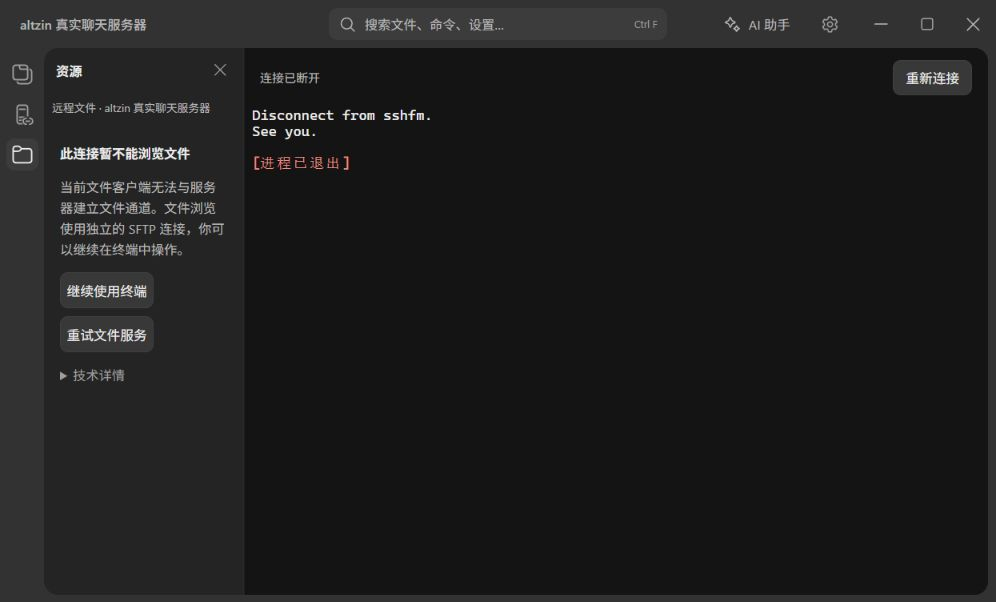
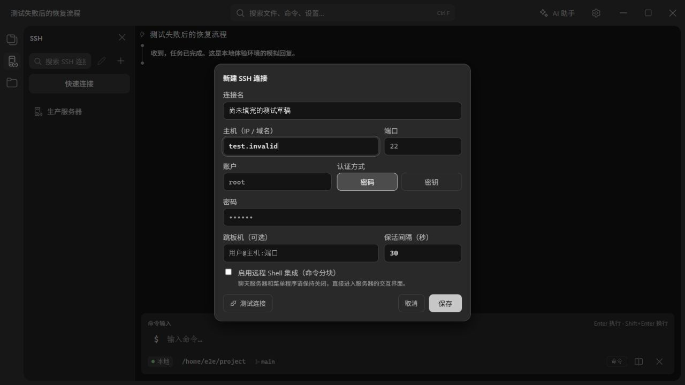
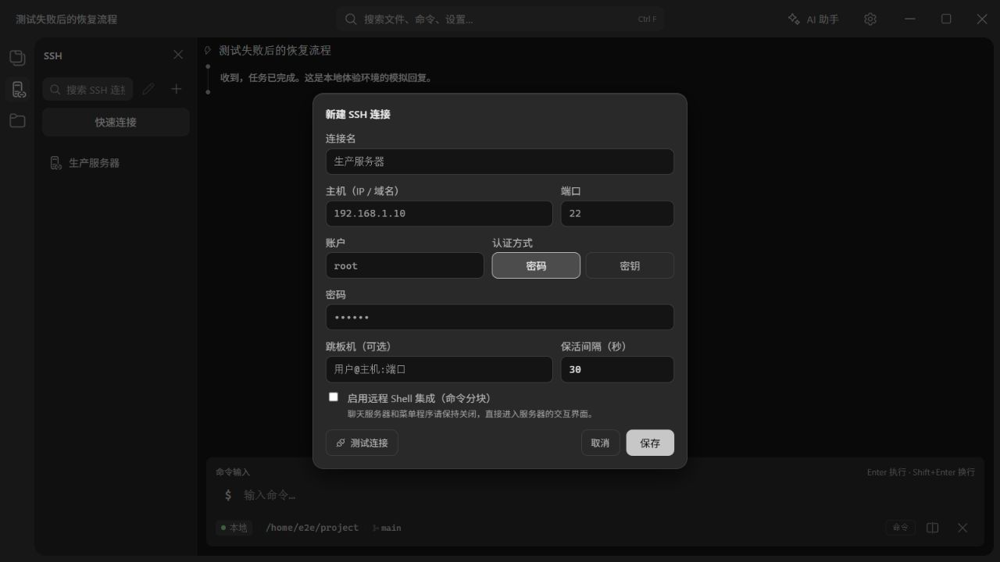

# 产品逻辑闭环体验记录（2026-10-05）

## 测试计划与判定方式

每个功能域至少走一条「入口 → 操作 → 可见结果 → 返回或恢复」主路径；对于输入与异步操作，再检查切页、取消、失败和重试。功能规格中的细分条目仍以 `docs/zh/feature-spec.md` 为索引。本记录不把打开一个页面算作完成外部服务验证。

执行顺序：真实 SSH 交互及文件能力降级 → 会话与分屏 → AI 对话和草稿 → 文件与搜索 → 设置各页 → 自动化回归。发现的界面问题保留复现步骤、影响和建议验收条件；没有真实验证的能力列入缺口，不标记通过。

环境与证据等级：

- **真实网络体验**：系统 SSH + 实际 PTY，连接 `www.altzin.com:2222`；生产 React、会话控制器与隐藏 xterm 渲染，通过临时本地 HTTP 适配器接收输出与发送按键。文件连接使用实际 libssh2 握手。
- **浏览器人工体验**：实际产品界面与交互，Tauri IPC、AI 回复、文件及配置存储使用隔离模拟数据。操作由浏览器工具完成，没有接管用户的原生桌面。此层不能证明原生文件选择、磁盘持久化、模型服务质量或外部工具运行成功。
- **自动化回归**：仓库的 Vitest、Playwright、Rust 测试。它们补充覆盖交互边界，不替代真实外部服务验收。

## 已执行的主路径

| 功能域 | 实际操作与结果 | 证据等级 / 仍需验证 |
|---|---|---|
| SSH 交互 | 任意测试账户与密码 → 数字验证码 → 主菜单 → 方向键进入 `/agent-intel` → Esc 返回根目录 → q 退出。验证码首次过期时也检查了关闭与重连 | 真实网络；通过。未向聊天参与者发送消息 |
| SSH 文件能力 | 真实文件客户端握手失败，但终端仍可正常操作；验证独立提示、技术详情与继续使用终端 | 真实握手 + 浏览器界面；握手不兼容不能直接推断服务器没有 SFTP |
| SSH 连接配置 | 打开快速连接 → 留空提交 → 主机与非法端口提交 → 取消；新建表单填写名称和主机 → 点击遮罩 → 重新打开 | 浏览器；端口校验可用，发现草稿丢失与空表单提示顺序问题。真实私钥及跳板机连接未验收 |
| 命令执行与命令块 | 输入 `echo vrykell-loop-check` → 输出、退出码与耗时显示 → 折叠再展开；右键打开菜单并点击复制命令 | 浏览器模拟 PTY；命令块操作可用。系统剪贴板写入未由模拟 IPC 验证 |
| 会话切换 | 新建 Bash 会话 → 输入未发送命令 → 切回原会话 → 返回 Bash | 浏览器；命令草稿隔离与恢复通过 |
| 分屏 | 选择类型 → 点击右侧落点 → 新分屏执行 `echo split-check` → 关闭分屏 | 浏览器；独立输出与关闭后恢复单屏通过 |
| 历史恢复 | 关闭测试 Bash 标签 → 会话历史 → 恢复刚关闭的会话 | 浏览器；会话恢复后未发送命令仍在。没有删除历史数据 |
| AI 基本对话 | 打开助手 → 输入问题 → 发送 → 显示模拟回复；关闭助手后终端恢复命令模式 | 浏览器；界面闭环通过，真实模型请求未验收 |
| AI 草稿与附件 | 编辑重发 → 修改草稿 → 关闭并重开助手；粘贴 3300 字文本变为附件 → 切换会话 → 返回原会话 → 移除附件 | 浏览器；草稿、附件按会话恢复通过。编辑重发会提前删除原对话，见问题 P1 |
| AI 模型与模式 | 打开模型选择器 → 搜索“本地” → 选择；打开对话模式下拉 → 选择 Chat | 浏览器；选择反馈和面板恢复通过 |
| AI 错误恢复 | 在模拟环境设置故障服务地址 → 发送 → 显示连接失败原因 → 恢复地址 → 返回同一会话 → 重新生成 → 显示成功回复 | 浏览器；恢复流程通过，没有向故障地址实际发送网络请求 |
| 本地文件 | 文件项打开新标签；进入无权限目录 → 明确错误 → 重试 → 上级目录 → 文件列表恢复 | 浏览器；错误与返回闭环通过。真实终端编辑器打开、编辑、保存未验收 |
| 下载管理 | 进入下载管理 → 空记录提示 → 返回文件浏览 | 浏览器；入口与返回通过。真实上传、下载、进度和取消未验收 |
| 全局搜索 | 搜索“主题” → 选择设置结果 → 进入主题页 | 浏览器；跳转通过。搜索数据为模拟返回，搜索准确率不属于本次通过项 |
| 命令面板 | Windows Ctrl+P → 输入“文件”过滤 → Enter 切换文件面板 → 浮层关闭 | 浏览器；操作通过，快捷键标签显示问题见 P2 |
| 主题与字号 | 切换浅色 → 打开自定义字号下拉 → 选 14px → 恢复默认 → 切回深色 | 浏览器；即时生效与保存状态通过；主题文件导入导出和真实重启保持未验收 |
| 模型配置与行为 | 设为当前模型；编辑系统提示词后立即切页再返回 → 值仍在 → 恢复原值 | 浏览器；切页提交通过；没有读取或修改用户真实密钥 |
| 模型权限与联网配置 | 核对分级权限并点击当前选项；查看网络搜索方式及未配置密钥提示 | 浏览器；没有降低权限。真实审批、联网搜索与网页抓取未验收 |
| 技能 | 打开列表 → 技能详情 → 查看正文 → 返回 → 技能市场 → 选择仓库 → 浏览列表 | 浏览器；详情、返回和市场界面可用；真实市场请求、导入、安装与脚本执行未验收 |
| MCP | 修改服务器显示名称 → 切页再返回 → 值已保存 → 恢复名称 | 浏览器；保存通过，但改名后连接状态变为未连接，见 P3。真实工具枚举与调用未验收 |
| 记忆 | 修改持久知识 → 立即切页 → 返回确认 → 恢复原文 | 浏览器；切页提交通过，AI 整理与真实对话注入未验收 |
| 子代理 | 修改说明 → 切页返回 → 确认保存 → 恢复原说明 | 浏览器；配置编辑通过，真实委派与结果回传未验收 |
| 定时任务 | 新增停用任务 → 改名、提示词和间隔 120 分钟 → 切页再返回确认值 | 浏览器；配置闭环通过。为避免后台自动触发，体验环境始终返回停用状态；未验收真实启停与按时执行 |
| 终端打开方式 | Bash 块模式改为经典 → 切页返回确认 → 恢复块模式 | 浏览器；配置保存通过，原生新 shell 的模式行为另有自动化覆盖 |
| 本地 / 远程编辑器 | 分别将默认命令 vim 改为 nano → 切页返回确认 → 恢复 vim | 浏览器；配置保存通过；实际编辑器运行未验收 |
| 快捷键说明 | 打开说明并实际使用 Ctrl+P | 浏览器；发现 Windows 显示 Mac 按键符号，见 P2 |

## 本轮修复

1. 保存的 SSH 连接打开后保留连接面板，不再强制打开文件浏览。文件面板被隐藏或折叠时不发起新的目录请求。
2. 文件服务失败区分能力不可用、认证问题及真实读取错误；文件通道握手不兼容使用中性提示。原始原因放在「技术详情」，提供「继续使用终端」和「重试文件服务」。连接未建立时不显示假的根目录及不可执行的上传、目录同步操作。
3. 切换 SSH 连接时重新建立对应文件视图，避免沿用另一连接的路径和错误。
4. 交互会话断开显示「已断开 SSH 连接」，只有认证中取消才显示「已取消认证」。
5. Windows PTY 在子进程已退出但主端句柄仍保留时，现在也会发出退出事件并清理会话；新增真实子进程退出检测测试。

## 已确认、尚未修复的问题

### P1：编辑重发在用户提交前删除原对话（高优先级）

复现：发送并收到回复 → 点击「编辑重发」 → 不发送，关闭助手再重开。草稿恢复了，但原提问、回答以及之后的对话已经从记录中删除。

代码依据：`src/features/chat/stores/chat.ts` 的 `editResend` 立即截断 `byTab` 并调用 `deleteChatMessage`。现有单测明确断言这种行为，因此自动化通过不会发现这个产品问题。

建议验收：编辑期间保留原对话；提供取消编辑；只在确认重新发送后替换目标对话及后续分支。用户关闭面板或切换会话时保留编辑草稿。

### P2：Windows 的快捷键标签显示 Mac 符号（中优先级）

复现：Windows 打开快捷键说明或 Ctrl+P 命令面板。实际 Ctrl+P 可用，但界面显示 ⌘P；其余快捷键也只显示 ⌘ / ⌥。

建议验收：用统一平台格式化方法显示 Windows/Linux 的 Ctrl / Alt / Shift 和 macOS 的 ⌘ / ⌥ / ⇧，同时覆盖设置与命令面板。

### P3：修改 MCP 名称后原连接丢失（中优先级）

复现：已连接服务器 → 只修改显示名称 → 切页返回。名称保存成功，但状态从「已连接 · 3 工具」变为「未连接」，需用户重新连接。

代码依据：`mcpPage.tsx` 改名时保存新名称并删除原名称；名称同时承担连接标识。浏览器模拟结果与这条调用路径一致，真实后端改名迁移仍需专门验收。

建议验收：使用稳定 ID 保存服务器配置与连接；如果修改必须重连，应在设置处说明，并明确提供重连入口。

### P4：遮罩关闭表单后未完成草稿丢失（高优先级）

复现：新建 SSH 连接 → 填名称和主机 → 点击遮罩 → 再次新建。两个字段都被清空。较大的表单和固定底部按钮解决了布局问题，但未解决误关后的恢复。

建议验收：保持用户要求的遮罩关闭；普通字段按新建、编辑和快速连接分别保留草稿；关闭不等于正式保存，不自动创建残缺连接；密码不写入普通持久化缓存。增加明确的「放弃草稿」操作。

### P5：快速连接空表单优先要求填写可选名称（低优先级）

复现：快速连接窗口不填任何字段，点击连接。名称标为「可选」，提示却是「请输入连接名」。填入主机后无名连接可以继续，说明主功能支持可选名称，只有校验顺序不合理。

建议验收：快速连接先提示必填主机、再提示端口；名称为空时由目标地址生成标题。

## 回归结果与真实体验缺口

- TypeScript 类型检查通过；`npm run build` 通过。构建仍有既有的 JS 包体积提示。
- Vitest：130 个测试文件通过、1 个跳过；807 个测试通过、1 个跳过。
- Playwright：全量 182 个测试通过，串行执行约 3.6 分钟。默认配置第一次因开发服务器启动等待超时未开始执行；随后用已运行的隔离 Vite 1423 服务及临时配置执行同一 `e2e/` 全量测试，没有删减用例。
- Rust：104 个测试通过、2 个忽略；包含 Windows 原生子进程退出检测。
- 架构检查与 `git diff --check` 通过。
- 新增回归覆盖：文件服务不可用与握手不兼容的分类、隐藏面板不加载、按需文件浏览、失败恢复、断开提示、原生 PTY 退出检测。

以下仍不能标记为「每项功能均已真实通过」：普通 SFTP 服务器的完整上传下载、真实私钥和跳板机、原生文件选择与编辑保存、真实 AI 服务和工具审批、联网搜索抓取、技能安装执行、MCP 工具调用、子代理执行与定时触发、主题导入导出及应用重启保持。现有模拟 E2E 对其中多项有覆盖，但本次真人式浏览器体验没有替代这些集成验收。

下一轮按顺序补充：先修 P1/P4 的输入恢复，再补上述外部集成主路径，最后做小窗口、中文输入法、弱网和重复操作的交叉回归。每项外部能力的验收必须包括真实结果、失败原因和恢复入口。
