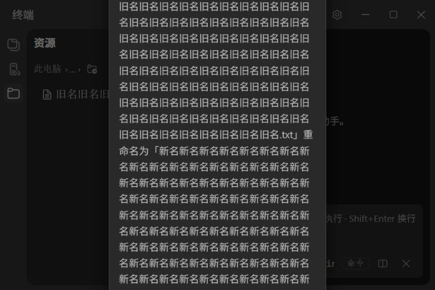
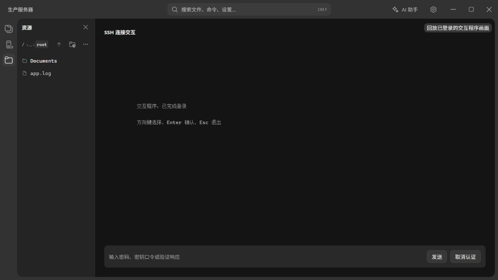

# 遮罩表单与 SSH 交互流程检查

日期：2026-10-05。

此前使用 Browser Use 操作实际前端组件，后端由本地测试夹具模拟。检查了 6 类遮罩窗口，以及 SSH 块模式的无 Shell 集成场景。该阶段没有操作用户的桌面窗口、真实连接数据、known_hosts 或外部 SSH 服务器。浏览器窗口尺寸为 1280×720 和桌面应用允许的最小尺寸 720×480；字号覆盖默认 13px 和设置允许的最大值 18px。用户随后授权连接外部聊天服务，真实连接结果见末尾补充记录。

## 遮罩窗口清单

| 场景 | 检查结果 | 证据与优先级 |
| --- | --- | --- |
| 新建、编辑 SSH 连接 | 宽度固定 400px，多字段集中在小区域；输入框约 28px 高，保存按钮约 56×30px；误关再开会重置所有未保存字段 | 浏览器复现新建草稿丢失，单测与 E2E 覆盖新建/编辑关闭行为。高 |
| SSH 测试中的首次主机指纹确认 | 确认弹窗嵌套在 SSH 表单遮罩中；点击上层遮罩取消时事件冒泡，底层连接表单也关闭，草稿丢失 | 浏览器通过模拟 `HOST_KEY_UNKNOWN` 复现，未点击信任按钮。高 |
| 文件重命名二次确认 | 名称先在列表里编辑，再进入遮罩确认；误关确认后新名字丢失。通用确认弹窗无最大高度和滚动区域 | 本地重命名复现草稿丢失和大字号长名称溢出。远程使用相同确认组件，取消状态由源码检查。中 |
| 文件删除、清空下载记录确认 | 没有待保存表单；仍共用缺乏高度上限的确认组件，长文件名和大字号组合可能影响按钮可达性 | 共用组件检查；清空下载记录文案短，本轮未复现尺寸问题。中/低 |
| 新建标签页 | 420px 宽，列表可滚动；只是搜索并选择现有类型/连接，不需要填写连接配置 | 浏览器输入搜索词、关闭；720×480 下过滤后的窗口约 145px 高。低 |
| 模型选择 | 480px 宽，有高度限制和独立滚动列表；模型选择立即生效，关闭只清除筛选条件 | 浏览器打开、搜索、关闭；720×480 下过滤后的窗口约 198px 高。低 |
| 全局搜索 | 480px 宽、有高度限制；输入是检索条件，没有多字段待保存配置 | 浏览器搜索、关闭；720×480 下窗口约 346px 高。低 |
| 命令面板 | 520px 宽、有高度限制；搜索后执行动作，没有待保存表单 | 浏览器搜索、关闭；720×480 下窗口高度上限 264px。低 |

上表将通用确认窗口按业务用途拆开，实际独立遮罩组件共 6 个：`SshFormModal`、`ConfirmDialog`、`NewTabModal`、`ModelPicker`、`GlobalSearch`、`CommandPalette`。思考强度与模型作用域的透明外侧点击层属于选项菜单；检查源码未发现多字段草稿。

设置页中的模型、MCP、记忆、子代理、定时任务、技能编辑等使用页内表单，未发现它们通过上述遮罩承载编辑。它们不计入本轮遮罩问题清单。

## 已复现的具体问题

### SSH 表单保存按钮被裁切

在默认字号、720×480 窗口下，SSH 弹窗最大高度为 393.6px，可见内容高度约 392px，但内容滚动高度为 427px。保存按钮底部在 y=455.2，超过弹窗底部 y=436.8，部分被裁切。点击「测试连接」出现「请先填写主机」提示后，滚动高度增至 467px，保存按钮移到 y=464.8–495.2，完全离开弹窗可见区域，需要滚动。

标题、表单与保存按钮在同一个滚动容器里；滚动到底部后标题和顶部字段消失。这使填写、检查、提交之间频繁往返。

源码：`src/features/ssh/components/SshFormModal.tsx`，尺寸在弹窗样式，字段重置在 `[open, initial]` 的 effect，提交在 `doSave`。

### 上层确认遮罩会关闭底层表单

复现：新建 SSH → 输入名称和主机 → 测试连接返回未知指纹 → 点击指纹确认窗口外侧。两层弹窗同时消失。`ConfirmDialog` 遮罩调用取消回调但没有阻止事件冒泡；外层 `SshFormModal` 遮罩也收到点击。

这和正常点击 SSH 表单自身遮罩关闭是两个不同操作：关闭上层指纹确认时应回到已经填写的表单。

源码：`src/ui/ConfirmDialog.tsx` 外层点击；`src/features/ssh/components/SshFormModal.tsx` 末尾嵌套确认。

### 长名称确认窗口超出屏幕

在 720×480、页面字号 18px 下，旧名称和新名称各为 224 个字符（220 个中文字符加 `.txt`）。确认窗口高度实测 754px，上边缘 y=-137，下边缘 y=617；取消和重命名按钮位于 y=564.6–600.2，完全不可见。它没有内部滚动来恢复按钮可达性。

这是长名称边界场景。默认字号、短旧名称配长新名称时没有复现溢出，不能据此将所有确认弹窗判断为日常不可用。



源码：`src/ui/ConfirmDialog.tsx`，仅限制宽度，没有最大高度或滚动区域。

## 用户提供的 SSH 操作：支持缺口

用户提供的终端记录覆盖：手输 SSH 命令、非默认端口、首次主机确认、密码提示、服务端文字提示和断开、登录后交互程序、超时退出。这些应作为完整流程的验收样本。记录中的迁移通知只是服务端输出；本轮没有执行其中的命令，也没有连接或核实外部服务状态。

### 已有能力

- 后端通过系统 SSH 与 PTY 启动会话，支持指定用户、端口和 `-t`。
- 连接管理入口已有主机指纹检查和显式信任流程。
- SSH 块模式已有独立密码/口令响应输入；经典模式已有直接终端输入路径。
- 管线已有普通画面和备用屏幕切换，VT/ANSI 解析使用 xterm.js。

因此，缺口集中在状态、输入和回退的产品闭环，而非需要单独适配某个 SSH 应用。

### 已复现并修复：无 Shell 标记的程序被留在认证界面

复现环境将 SSH 打开模式设置为块模式，并模拟没有 OSC 133 Shell 集成的服务。通过测试夹具回放清屏与光标定位输出，显示「交互程序：已完成登录」「方向键选择，Enter 确认，Esc 退出」。界面仍显示「SSH 连接交互」、密码响应输入和「取消认证」。测试后已恢复原来的经典模式设置。

`TerminalPanel` 将 SSH 交互界面绑定在经典场景；控制器收到远端 Shell 的提示标记才切换到块列表。旧逻辑用整屏文本识别并记住已处理的密码提示，登录后的屏幕重绘会改变文本，从而再次显示密码响应框并遮住 xterm。程序不发送 Shell 标记时，用户无法顺畅回到方向键、Enter、Esc 等终端按键操作。

修复后，密码提示按当前提示行识别；同一提示在屏幕重绘后不会重新弹出，认证被拒绝后则会重新提供响应框，用户也可手动切换到密码输入或直接终端输入。SSH 的 xterm 挂载节点在块列表场景继续保留，进入备用屏幕程序时恢复原终端画面。没有 Shell 集成的服务器仍使用 xterm 的原生交互路径，不依赖程序名或手写 VT 解析。



源码：`src/features/terminal/components/TerminalPanel.tsx:25`、`src/features/terminal/hooks/useTerminalSession.ts:204`、`src/features/terminal/services/pipeline/sessionController.ts`。

这张图验证的是本地模拟输出经过实际前端后的行为；用户贴出的文本没有保留原始 ANSI 序列，无法判断该外部程序是否使用备用屏幕。因此不能声称已经在 sshfm 上复现同一故障。

### 源码确认的其他闭环风险

| 环节 | 当前行为与风险 | 后续验收重点 |
| --- | --- | --- |
| 登录普通终端后执行 `ssh` | 底部命令输入仍按普通命令提交，会设置待执行命令；没有专门的子进程响应模式 | `yes/no`、密码和验证响应应发给当前进程；密码不进入命令历史或 AI 上下文 |
| 无远端 Shell 集成/强制交互程序 | 块模式附加远端 Shell 集成命令；回退后仍可能停留在认证界面 | 服务不支持集成或拒绝远端命令时保留通用交互路径；不依赖识别程序名 |
| 交互程序按键 | 普通终端与备用屏幕已有按键路径；独立认证表单只提交整行文字 | 方向键、Enter、Esc、Tab、退格、Ctrl+C、窗口缩放在对应阶段可用；不能把普通输入都当密码 |
| 远端关闭连接 | PTY 退出时清除会话并输出「进程已退出」；认证视图输入禁用，但没有完整重连入口和断开原因展示 | 保留最后输出、显示断开状态、支持重连；与本地 Shell 中运行 SSH 后返回本地提示符区分 |
| 终端与远程文件面板 | 双击连接会自动打开文件面板；文件服务使用另一条 SSH/SFTP 认证路径 | 交互式服务没有 SFTP、终端临时密码或交互挑战时，文件错误不妨碍终端继续操作 |
| 测试连接 | `ssh_test_sync` 的「连接成功」只验证连接与认证 | 不应把它当作远端 Shell、交互应用、SFTP 均可用的验证结果 |

## 建议修复顺序

1. SSH 表单扩大填写空间，字段和按钮统一到更易点击的尺寸；标题和底部操作区保持可见，只有正文滚动。继续允许点击遮罩关闭。**已完成**：弹窗收敛为 480px 宽的紧凑双列布局，正文滚动、操作区固定，详见「后续修复记录」。
2. 给新建/编辑 SSH 保存草稿并支持重新打开恢复。区分草稿保存和正式连接提交；不完整字段也可保留。密码草稿只放在当前运行期内存，避免新增明文持久化。（未修复）
3. 修复嵌套确认的点击冒泡；上层取消只退出指纹确认并返回原表单。（未修复）
4. 通用确认窗口限制高度，长内容独立滚动；重命名取消确认后回到原输入并保留新名字。重命名涉及真实文件变更，草稿保留不会提前执行文件操作。（未修复）
5. 补齐 SSH 无集成回退，认证提示与已登录交互分开处理；保留 xterm 原生按键与备用屏幕画面。（本轮已修复并通过 mock E2E；真实 SSH 服务器复验尚未执行）

## 下一轮 SSH 验收计划

本轮以下矩阵是待执行计划，不能标记为真实后端验收通过。使用可控的测试 SSH 服务和非敏感测试账号，服务端能够重现提示、原始按键、普通屏幕/备用屏幕、退出和 SFTP 能力差异。

| 场景 | 至少一次完整体验 | 通过标准 |
| --- | --- | --- |
| 普通终端手输 SSH | 命令 → 首次指纹拒绝/确认 → 密码 → 退出返回本地 | 提示和输入对应同一进程，密码不泄漏；返回原本地输入状态 |
| 连接管理入口 | 新建草稿 → 误关恢复 → 保存 → 测试 → 连接 | 草稿恢复、按钮始终可达、验证与连接的状态可理解 |
| 非默认端口和未知/变化指纹 | 使用测试端口，拒绝一次、确认一次、模拟密钥变化 | 端口准确；拒绝不启动会话；密钥变化明确拒绝 |
| 认证失败与重试 | 错误密码 → 再次提示 → 正确测试密码 | 一次输入不被记成新命令，重试成功后退出认证阶段 |
| 密钥口令/交互认证 | 服务端要求多轮响应 | 每个提示都可回应，取消清理对应连接 |
| 无 Shell 集成 | 登录后普通提示符，不发 OSC 标记 | 可输入和执行命令，支持退出；不会一直显示密码框 |
| 直接进入交互程序 | 普通屏幕与备用屏幕各一次 | 方向键、Enter、Esc、Tab、退格、Ctrl+C 和缩放正确传递 |
| 服务端提示后主动断开 | 输出迁移或退出文字后关闭连接 | 提示保留、断开状态清晰、可重连；不继续向失效 PTY 写入 |
| 超时与程序退出 | 用户自行完成交互挑战；模拟超时返回 | 计时和最终输出可见；退出后的连接状态准确 |
| 没有 SFTP 的服务 | 终端成功，文件通道明确不支持 | 终端照常可用，文件面板显示能力说明与恢复入口 |

## 本轮代码与验证

- 按最新要求恢复 SSH 表单外侧遮罩关闭；保留填写区域内阻止冒泡的行为。
- 更新对应单测、2 个 E2E 用例与 `docs/zh/feature-spec.md` 的 SSH11。
- TypeScript 检查通过。
- 全量 Vitest：128 个测试文件通过、1 个跳过；796 个测试通过、1 个跳过。
- SSH 表单关闭 E2E：新建、编辑 2 个用例通过。没有运行全量 E2E 或真实 Rust/SSH 后端验收。
- 本轮其余表单尺寸、草稿、嵌套确认与远端断开状态问题仅记录和复现，尚未修复；SSH 块模式无 Shell 集成交互及 TUI 恢复已在下方单独修复并验证。

### SSH 块模式的无集成交互与 TUI 恢复

- 密码响应框现以当前提示行为依据，使用已处理的提示文本而不是整屏快照判断是否重复；认证拒绝后重新显示响应框，用户切到直接输入后不会被同一旧提示抢回焦点。
- SSH 面板在块列表场景隐藏时继续保留 xterm 挂载节点，避免备用屏幕程序返回时显示空终端。
- Vitest 覆盖旧提示、拒绝重试和直接输入；Playwright 覆盖无 OSC 133 服务器的方向键/Enter/Esc，以及 SSH 块运行中进入备用屏幕后 xterm 画面恢复。测试使用 mock PTY，尚未在外部服务器复验。

### 2026-10-06：SSH 块输入提交后没有输出

上一轮修复仅覆盖认证输入与场景切换，没有覆盖用户在块输入栏提交 `ls` 的实际命令链路。本轮补充复现：远端发送提示标记后，若缺少命令开始标记，提交的命令不会进入执行状态，输出一直留在未显示的待执行缓冲区；结束标记也无法生成输出快照。

- 块输入栏提交命令时立即启动对应输出块，后续 OSC 133;C 不重复启动；没有 Shell 集成的 SSH 会话继续走原生终端输入路径。
- 远端注入命令不再对整个交互 Shell 使用 `2>/dev/null`，命令错误输出可以经 SSH 回到界面。
- 实际 SSH 输出的视觉检查还发现快照尾部空行被字距样式包装为非空 HTML，导致短输出占据整个终端高度并被滚动到视区外。现保留空行的空表示，裁掉尾部空行，同时保留内容之间的空行；E2E 增加短输出块高度与输出进入视区的断言。
- 新增单测及持久化 E2E 覆盖完整/缺少 preexec 标记时连续执行 `ls`、`pwd`；Rust 测试实际运行远端 Bash 启动脚本，确认输出、状态标记与标准错误保留。
- 另以临时测试桥将浏览器中的真实 Vrykell 输入栏接到 Windows OpenSSH，再连接隔离的本地 SSH 服务和实际 Bash 启动脚本。完整/缺少 preexec 标记两种配置均验证了两次 `ls`、`pwd` 与 `ls missing-test-path`：输出显示、错误可见、执行状态完成。此验证使用真实 SSH 传输和 Shell；桌面 ConPTY 与 Tauri IPC 仍由测试桥替代，没有使用用户远端账户。
- [实际 SSH 命令输出与错误状态截图](../audit-evidence/2026-10-06/ssh-block-real-command-flow.png)。
- 最终验证：TypeScript、构建与架构检查通过；Vitest 834 项通过、1 项跳过；Rust 108 项通过、2 项忽略；持久化 Playwright 套件 198 项全部通过。额外的真实 OpenSSH 浏览器测试两种配置均通过。

## 后续修复记录

### SSH 连接表单尺寸与按钮可达性

把弹窗从 620px 宽的单列长表单收敛为 480px 宽的紧凑布局：主机/端口、账户/认证方式、跳板机/保活间隔各占一行两列；标题与操作区固定，只有正文滚动；「测试连接」移到操作区左侧，与「取消」「保存」同排。

- 默认 1240×800：弹窗高约 470px，全部字段和按钮一次可见。
- 最小窗口 720×480 且字号放大到 1.4 倍：弹窗不超出窗口，保存、取消、测试连接始终在弹窗内，正文独立滚动。
- 顺带修正可访问性问题：「认证方式」原先用 `<label>` 包住两个按钮，使「密码」按钮的可访问名字被标签文本覆盖；现改为带 `aria-label` 的按钮组，两个按钮各自保留自己的名字。
- 回归覆盖：`e2e/ssh-form-preservation.spec.ts` 新增尺寸用例（默认窗口、最小窗口 + 大字号、密钥模式输入行宽度），SSH 相关 E2E 与单测通过。

### 整宽输入框的焦点描边被裁切

实测发现聚焦「密码」输入框时，焦点环左右两侧被切掉。原因是主题的焦点样式为 `outline: 1px` + `outline-offset: 2px`，即向外扩 3px；而滚动正文区 `padding: 0`、输入框又是整宽，描边正好落在 `overflow: auto` 的裁剪边界之外，左右各缺一段。

修复方式是在滚动正文区使用 `margin: -4px` + `padding: 4px` 让出 4px 余量：裁剪边界外移到弹窗内边距里，字段位置与标题、操作区保持对齐不变。回归用例在滚动正文区内测量输入框四边余量，要求至少 3px，覆盖连接名与密码两个整宽字段。

草稿保存、嵌套确认冒泡、通用确认窗口高度上限仍未修复。

### SSH 连不上：指纹预检失败被当成硬门槛

从本机诊断日志（`%LOCALAPPDATA%\com.vrykell.app\logs\terminal-debug.jsonl`）看到：13 个 SSH 面板里只有 3 个真正把 PTY 起起来，其余在几十毫秒内以 `pty-spawn-error` 结束，而且所有 SSH 请求的端口都是 22——聊天服务器的 2222 从未到达后端。

用生产代码写了一个真机探针（`cargo test manual_chat_server_flow -- --ignored --nocapture`）复现后确认：libssh2 前置校验对 `www.altzin.com:2222` 直接失败（`[Session(-5)] Unable to exchange encryption keys`），而 `prepareSshHost` 把它当成致命错误抛出，真正的 `ssh` 因此从未启动。同一个服务器用系统 OpenSSH 可以正常登录、显示验证码界面并断开。

修复：预检失败不再阻断连接，改由 ssh 客户端自己校验——已记录主机仍严格比对，未知指纹在终端内询问（`StrictHostKeyChecking=ask`）；用户主动取消或已记录密钥发生变化时仍然中止。探针在修复后的参数下连上了服务器：密码被接受（1.4s），sshfm 界面完整渲染，超时后按服务端行为断开。

范围说明：探针验证的是后端链路（命令构造、PTY、真实密码/验证码交互）；前端渲染与按键联动由 e2e 夹具覆盖，未在真实服务器上逐键验证。

## 补充：真实 SSH 聊天服务器体验

用户明确授权后，使用系统 OpenSSH 连接 `www.altzin.com:2222`。这次是外部服务器真实连接，不是测试夹具；连接入口是独立工具终端，未通过 Vrykell 前端，因此不能把它标为项目端到端通过。

连接命令：

```powershell
ssh -tt -p 2222 -o ConnectTimeout=12 -o StrictHostKeyChecking=yes vrykell_test@www.altzin.com
```

使用临时测试用户名与任意测试密码，沿用已有主机信任记录。没有修改 known_hosts，没有使用用户真实凭据。

实际完成的流程：

1. 服务端提示密码，任意测试密码通过。
2. 服务端进入有倒计时的数字挑战画面；本次通过挑战后显示 `captcha passed`，进入 sshfm 主界面。
3. 主界面显示目录列表、实时状态及原始按键操作提示；方向键选择，Enter 打开 `Test` 目录，路径变为 `/Test`。
4. Esc 返回根目录，路径恢复为 `/`。
5. 按界面提示的 `q` 退出，显示 `Disconnect from sshfm.` / `See you.`，随后 SSH 连接关闭。工具进程返回码为 1，退出前服务端明确显示主动退出信息。

没有发送聊天消息、广播、修改昵称、创建或修改文件、删除内容，也没有将其他参与者的消息或地址保存到报告。

服务器在认证后直接提供交互界面，而非普通 Shell 提示符。工具终端可见清屏、光标定位、行擦除、反色和光标显示切换等控制序列。由于系统终端会处理和重发控制序列，这份工具输出不能当作原始 SSH 字节流，也不能据此断言服务器绝不发送备用屏幕序列或 OSC 标记。

真实体验确认了下一轮项目验收必须覆盖：登录后立即接入交互程序、倒计时画面持续刷新、方向键与 Enter/Esc 原样透传、目录切换后画面更新，以及退出后连接状态恢复。此前项目块模式的模拟故障仍是单独的前端复现，尚未在 Vrykell 内用这个真实服务器完成验收。

## 2026-10-06：SSH 空输出核查与命令块图标调整

- 对照用户自动保存的诊断日志，两条 `ls` 命令均正常结束，原始块输出仅含清屏与空行重绘，没有目录条目。
- 使用现有连接和已有主机信任记录执行只读核查：用户主目录的非隐藏条目数为 0，`ls` 无输出符合远端实际结果；`pwd`、`ls /usr` 和标准错误输出均正常返回。没有修改远端文件或设置。
- 使用生产 SSH 命令构造器、实际远端启动脚本、Windows OpenSSH、ConPTY 和同步扫描器重测了上述命令。认证内容与凭据不保留；脱敏后的四条命令输出存为 `e2e/fixtures/ssh-conpty-output.json`，浏览器回放覆盖前端块渲染，此回放不代表完整桌面 IPC 验收。
- 用户要求空输出保持空白，移除无输出提示。已完成和运行中块统一为 28px 按钮、14px 操作图标；折叠/展开箭头为 12px。
